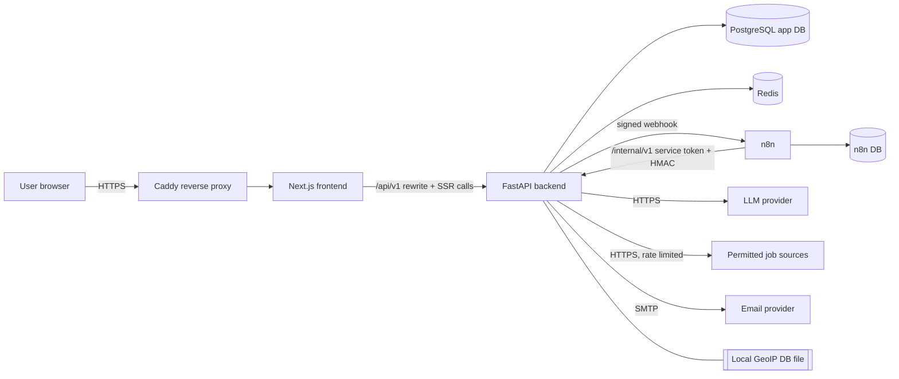
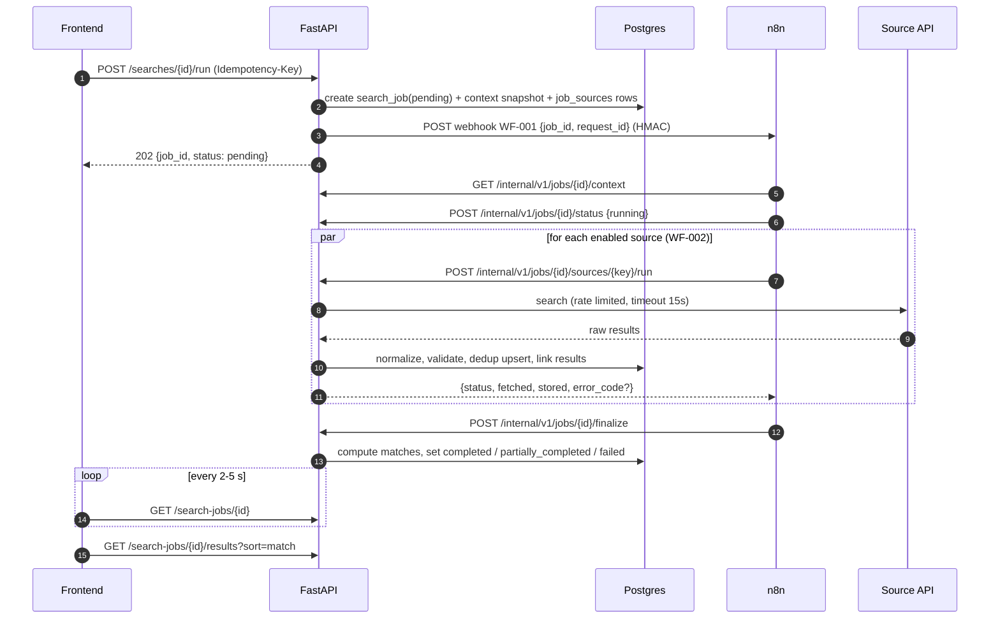
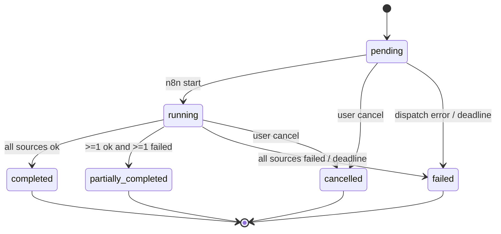
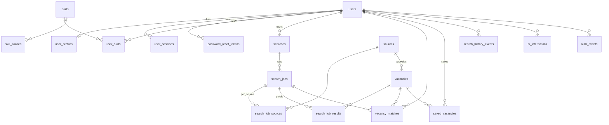

# Architecture Plan — AI Job Assistant

| Field | Value |
|---|---|
| Based on | `docs/SRS.md` v1.0, `requirements-analysis.md`, `technical-decisions.md` |
| Status | Proposed (pending product-owner approval of TD-06, TD-07) |
| Scope | MVP, designed so post-MVP extensions don't need a rewrite |

---

## 1. Architectural Principles

1. **The backend is the system of record and the rule engine.** FastAPI owns auth, validation, state, normalization, dedup and matching. n8n orchestrates. The AI suggests and explains (SRS §15, §18; TD-06).
2. **Contract first.** One canonical `SearchParams` schema. OpenAPI generates the frontend types. Internal n8n↔backend endpoints have their own versioned schemas (TD-10, TD-19).
3. **Fail partially, never silently.** A source or the AI can fail without breaking the job. Every degradation is visible to the user (SRS §4.2).
4. **Idempotent everything.** Every write from asynchronous actors can be safely replayed (SRS §8.5; TD-12).
5. **Privacy by default.** Collect the minimum, store no raw IPs or coordinates, keep AI content off by default, hard-delete on request (SRS §10; TD-15, TD-24).
6. **Compliance per source.** A source runs only after a documented review. Storage and display follow its policy (SRS §3.6, §17; TD-23).
7. **Replaceable edges.** AI provider, job dispatcher, email and GeoIP sit behind interfaces (SRS §4.3).

---

## 2. System Context



**Trust boundaries**
- Public: only Caddy (443). It routes the app domain to Next.js. An optional separate host routes to the n8n editor behind SSO/IP allow-list (never public without auth).
- Private network: backend, Postgres, Redis, n8n, n8n-db. The backend is not directly reachable from the internet (TD-05).
- External egress: AI provider, sources, email.

---

## 3. Responsibility Matrix

| Capability | Frontend | Backend | n8n | AI provider |
|---|---|---|---|---|
| Rendering, forms, client validation | ✔ | | | |
| AuthN/AuthZ, sessions, CSRF | cookie handling | ✔ | | |
| Profile, settings, consent | UI | ✔ | | |
| Location estimate | display/edit | ✔ (GeoIP) | | |
| Query parsing / clarification | chat UI | ✔ orchestrates, validates, grounds | | ✔ generates |
| Search + job creation, state machine | polling UI | ✔ | reports transitions | |
| Job context snapshot | | ✔ | reads | |
| Fan-out to sources, timeouts, retries | | | ✔ | |
| Source adapter call, normalize, validate | | ✔ | | |
| Dedup, persistence | | ✔ | | |
| Matching (scores, levels, skills) | display | ✔ | | |
| Match explanation prose | display | ✔ validates | | ✔ (optional) |
| Scheduled jobs (sweeper, re-verify, FX, retention) | | ✔ logic | ✔ Cron triggers | |
| Saved, compare, history | UI | ✔ | | |

---

## 4. Backend Architecture

### 4.1 Layers
```
api (routers, request/response schemas, auth dependencies)
  → services (use cases, transactions, business rules)
    → repositories (SQLAlchemy queries; every user-scoped query takes user_id)
      → models (ORM)
integrations (ai, sources, geoip, email, n8n) ← called by services only
core (config, security, errors, logging, rate limiting, i18n keys)
```
Rules: routers contain no business logic. Services never import FastAPI. Repositories never commit (the unit of work lives in the service). User-scoped repository methods **require** `user_id` as a parameter. This is the main defense for AUTH-005, and the authorization matrix tests cover it.

### 4.2 Directory structure (refines SRS §12)
```
backend/
  app/
    main.py                      # app factory, middleware, routers
    api/
      deps.py                    # get_db, current_user, require_csrf, service_auth
      v1/  auth.py profile.py settings.py account.py searches.py jobs.py
           vacancies.py saved.py compare.py ai.py location.py history.py
      internal/v1/  jobs.py sources.py maintenance.py
      health.py
    core/  config.py security.py errors.py logging.py rate_limit.py ids.py
    db/    session.py base.py
    models/ user.py session.py profile.py skill.py search.py job.py source.py
            vacancy.py match.py saved.py history.py ai_interaction.py audit.py fx.py
    schemas/ (Pydantic DTOs incl. search_params.py = SearchParamsV1)
    repositories/ one per aggregate
    services/ auth_service.py profile_service.py search_service.py job_service.py
              ingest_service.py dedup.py normalization/ matching/ ai_query_service.py
              explanation_service.py location_service.py history_service.py
              account_service.py retention_service.py
    integrations/
      ai/ provider.py anthropic_provider.py prompts/ guards.py
      sources/ base.py registry.py mock/ <source_key>/ (adapter + fixtures)
      geoip/ email/ n8n/ (dispatcher.py: N8nDispatcher, InlineDispatcher)
    cli.py                       # admin commands: sources enable/disable, delete user, seed
  alembic/  tests/ (unit/, integration/, authz/, fixtures/)  pyproject.toml  Dockerfile
```

### 4.3 Cross-cutting middleware (in order)
Security headers → request ID + structured access log (+ last-resort 500 envelope) → body size limit (64 KB) → router → exception handlers (map to the error envelope). Security headers are outermost so every response gets them, including 413 and 500. These are pure ASGI middlewares in `app/api/middleware.py`. Rate limits are not a middleware: they need the parsed request (e.g. the email of a login) and the outcome (only failed logins count), so services apply them through `app/core/rate_limit.py` (auth: `app/services/auth_guard.py`). Session loading and the CSRF check are FastAPI dependencies (`CurrentAuth`, `CsrfProtectedAuth` in `app/api/deps.py`) rather than middleware: routes declare what they need, and `tests/authz/` fails if a non-public route lacks authentication or an unsafe one lacks the CSRF check.

### 4.4 Rate limit groups (initial)
| Group | Limit |
|---|---|
| `auth:login` | Failed logins: 5/min per IP+email, 20/hour per IP. Lockout 15 min after 10 failures in a row on an account (database, not Redis). |
| `auth:register`, `auth:forgot` | 5/hour per IP; forgot also 3/hour per email |
| `auth:reset` | 10/hour per IP |
| `auth:change-password` | 5 per 15 min per user |
| `ai:*` | 10/min, 50/day per user (TD-07) |
| `search:run` | 20/hour per user + 2 active jobs (TD-12) |
| default authenticated | 120/min per user |
| internal | none (service auth + network isolation) |

---

## 5. Frontend Architecture

### 5.1 Routes (App Router, locale-prefixed)
```
/[locale]
  (public)   page.tsx (landing) · login · register · forgot-password · reset-password
             legal/privacy · legal/terms
  (app)      dashboard · search/new (form) · search/ai (chat) · search/[searchId]
             jobs/[jobId] (progress → results) · vacancies/[vacancyId]
             saved · compare?ids=… · history · profile · settings (account, privacy, personalization)
  not-found · error
```
`middleware.ts`: locale negotiation. It redirects `(app)` routes to login when there is no `sid` cookie (a fast check only). Real authorization always happens on the backend. The `(app)` layout fetches `/auth/me` on the server.

### 5.2 Structure
```
frontend/
  app/            routes above
  features/       auth/ profile/ search/ ai-chat/ jobs/ results/ vacancy/ saved/ compare/ history/ settings/
                  (each: components/, hooks/ (TanStack Query), schemas.ts (Zod), api.ts)
  components/ui/  shadcn primitives themed by tokens
  components/     layout, navigation, empty/error/loading states, MatchBadge, SalaryText, SourceAttribution, FreshnessNotice
  lib/            api-client.ts (openapi-fetch + CSRF header + error mapping), query-client.ts, format.ts (Intl), i18n.ts
  types/          api.d.ts (generated from OpenAPI — never edited by hand)
  messages/       en.json ru.json
  styles/         tokens.css (CSS variables: color, spacing, radius, shadow, z-index), tailwind config maps tokens
  tests/          unit (vitest), e2e (playwright)
```

### 5.3 Data and state
- Server state only through TanStack Query. Query keys per resource. Mutations invalidate the related keys. Optimistic updates for save/unsave and notes.
- Forms use React Hook Form + Zod. Schemas are derived from the generated types plus UX rules. Errors show next to the field (SRS §4.4). Backend `VALIDATION_ERROR.details` is mapped to field errors.
- The AI chat is local component state with the conversation turns. The server is stateless between turns: the client sends the previous params + answers (AI-003 "current params").
- The compare selection is kept in the URL (`?ids=`) + a sticky tray. Limit 2–5 is enforced in the UI and API.
- The landing page query for a guest goes to `sessionStorage` and is restored after auth (AMB-01).

### 5.4 Design system
Tokens (SRS §9.5) as CSS variables with a light theme, and a dark theme in the structure but not shipped. shadcn components restyled from tokens. Required component states (SRS §9.4) are implemented as variants, with a Storybook-lite page (`/dev/components`, dev-only) for visual QA against Figma.

---

## 6. Search Pipeline

### 6.1 Sequence (production, n8n dispatcher)


### 6.2 Job state machine

- Transitions are validated in `job_service`. A repeated identical transition is a no-op (idempotent). Illegal transitions → `409`.
- `deadline_at = created_at + SEARCH_JOB_DEADLINE_SECONDS` (default 120 s). The sweeper (n8n Cron every minute → `POST /internal/v1/maintenance/sweep-jobs`) finalizes overdue jobs with the results they have. The same check runs lazily on `GET /search-jobs/{id}`, so stuck jobs are resolved even if n8n is down (NFR-07).
- **Re-run** of a search = a new job. The previous job's results stay readable until history is deleted.

### 6.3 Job context snapshot
Created with the job and stored in `search_jobs.context JSONB`: `SearchParamsV1` + a permitted profile subset (only if `ai_use_profile`/matching allows it): desired roles, skills, experience level, languages, salary expectation, work formats, relocation, location. This makes runs reproducible, gives n8n a single fetch (CON-04), and means later profile edits don't change a running job.

---

## 7. Data Architecture

### 7.1 Entity-relationship overview


### 7.2 Table specification (delta vs SRS §7 in **bold**)
| Table | Key columns | Constraints / indexes |
|---|---|---|
| users | id, email `citext`, password_hash, is_verified, preferred_locale, timezone, **is_admin, terms_version, privacy_version, terms_accepted_at, failed_login_count, locked_until**, created_at, updated_at, last_login_at | UNIQUE(email) |
| **user_sessions** | id, user_id, token_hash, created_at, last_seen_at, expires_at, user_agent, ip_prefix (/24 or /48) | UNIQUE(token_hash), idx(user_id), ON DELETE CASCADE |
| **password_reset_tokens** | id, user_id, token_hash, expires_at, used_at | UNIQUE(token_hash) |
| **email_verification_tokens** | same shape | |
| user_profiles | SRS fields + **desired_roles JSONB, languages JSONB (code+level), salary_period, ai_use_profile bool default true, ai_use_history bool default false** | UNIQUE(user_id) |
| skills | id, name, normalized_name | UNIQUE(normalized_name) |
| **skill_aliases** | alias_normalized, skill_id, locale | PK(alias_normalized) |
| user_skills | user_id, skill_id, skill_level, years_experience | PK(user_id, skill_id) |
| searches | id, user_id, original_text, normalized_params JSONB, **params_schema_version, channel (form/ai), status (draft/confirmed/archived), title (display)**, created_at, updated_at | idx(user_id, created_at desc) |
| search_jobs | id, search_id, user_id, status, **idempotency_key, request_id, context JSONB, deadline_at, cancel_requested_at, progress JSONB**, started_at, finished_at, error_code, error_message, result_count, **created_at** | UNIQUE(user_id, idempotency_key); partial idx on status in (pending, running) |
| **search_job_sources** | search_job_id, source_id, status (pending/running/succeeded/failed/timed_out/skipped), fetched_count, stored_count, error_code, duration_ms | PK(search_job_id, source_id) |
| **search_job_results** | search_job_id, vacancy_id, rank, match_score (internal) | PK(search_job_id, vacancy_id) |
| sources | id, name, base_url, source_type (api/rss/ats), is_enabled, terms_url, created_at, **adapter_key, rate_limit JSONB, storage_policy, retention_days, attribution_text, compliance_reviewed_at, compliance_notes** | UNIQUE(adapter_key) |
| vacancies | SRS fields + **company_normalized, region, language, salary_period, salary_raw, location_raw, description_snippet, salary_monthly_min_eur, salary_monthly_max_eur, duplicate_group_id, removed_at**; description nullable | UNIQUE(source_id, external_id) WHERE external_id IS NOT NULL; idx(canonical_url); idx(content_hash); GIN trgm(normalized_title); GIN(skills) |
| vacancy_matches | SRS fields (**`search_id` replaced by** `search_job_id`, the search is reached through the job) + **factors JSONB, algorithm_version, explanation_locale, explanation_source (template/ai)** | UNIQUE(search_job_id, vacancy_id); idx(user_id, vacancy_id, created_at desc) |
| saved_vacancies | id, user_id, vacancy_id, note, created_at, **updated_at** | UNIQUE(user_id, vacancy_id) |
| search_history_events | as SRS | idx(user_id, created_at) |
| ai_interactions | SRS fields + **task, prompt_version, request_id, error_code, cost_estimate_usd** | idx(user_id, created_at) |
| **auth_events** | id, user_id nullable, email_hash, event_type (login_succeeded/login_failed/account_locked/rate_limited/password_changed/password_reset_requested/password_reset), detail, ip_prefix, user_agent, created_at | idx(created_at), idx(user_id, created_at) |
| **audit_log** | id, actor (user/admin/system), subject_hash, action, metadata JSONB, created_at | append-only |
| **fx_rates** | date, currency, rate_to_eur | PK(date, currency) |

The implemented schema, column by column, is in `docs/database.md`. All timestamps are `timestamptz` (UTC). Enums are Postgres `text` + CHECK constraints, so they can grow without enum migrations. All user-owned FKs use `ON DELETE CASCADE` from `users`. Vacancies aren't user-owned.

### 7.3 Migrations and seed
Alembic migration files are autogenerated, then reviewed by hand. There is one migration per feature PR. Downgrades exist for the most recent migrations. Seed: `sources` (mock + reviewed sources, disabled by default), `skills` + `skill_aliases` (curated ~500 tech/business skills with EN/RU aliases).

---

## 8. API Design

### 8.1 Conventions
- Base `/api/v1`, JSON UTF-8, snake_case fields, ISO-8601 UTC timestamps, UUIDs.
- Error envelope: `{"error": {"code", "message", "details", "request_id"}}`. `message` is English developer text. The UI translates `code`.
- Pagination: cursor (`?cursor=&limit=` → `{items, next_cursor}`), maximum limit 100.
- Cross-user resources → `404 NOT_FOUND`.
- Unsafe methods need the `X-CSRF-Token` header. `POST .../run` accepts `Idempotency-Key`.

### 8.2 Public endpoints (SRS §6 + additions marked ★)
| Area | Endpoints |
|---|---|
| Auth | `POST register`, `POST login`, `POST logout`, `POST forgot-password`, `POST reset-password`, `GET me`, ★`POST change-password`, ★`POST verify-email`, ★`POST resend-verification`, ★`POST logout-all` |
| Profile | `GET/PATCH /profile`, `GET/PUT /profile/skills`, `DELETE /profile` (clears profile data), ★`GET /skills?q=` (skill dictionary autocomplete) |
| ★Settings | `GET/PATCH /settings` (`preferred_locale`, `timezone`, `ai_use_profile`, `ai_use_history`; locale and time zone keep the names registration and `/auth/me` use), `GET /settings/personalization` (what data is held and where it is used, PROFILE-004) |
| ★Account | `DELETE /account` (password re-auth), `GET /account/export` (Should) |
| Search | `POST/GET /searches`, `GET /searches/{id}`, ★`DELETE /searches/{id}`, `POST /searches/{id}/run`, ★`GET /searches/{id}/jobs`, `GET /search-jobs/{id}`, `POST /search-jobs/{id}/cancel`, ★`GET /search-jobs/{id}/results` |
| Vacancies | `GET /vacancies` (only vacancies visible to the user: in their jobs or saved), `GET /vacancies/{id}`, ★`GET /vacancies/{id}/match`, `POST/DELETE /vacancies/{id}/save`, `GET /saved-vacancies`, ★`PATCH /saved-vacancies/{id}` (note), `POST /vacancies/compare` |
| AI | `POST /ai/parse-query`, `POST /ai/clarify`, `POST /ai/confirm-query` (→ creates a confirmed `search`) |
| Location | `GET /location/estimate`, `PATCH /location/preference`, ★`POST /location/resolve` (browser coords → city, coordinates not stored) |
| ★History | `GET /history`, `DELETE /history` |
| Health | `GET /health`, `GET /ready` |

### 8.3 Internal endpoints (n8n → backend), `/internal/v1`
Auth: `Authorization: Bearer <service token>` + `X-Signature: sha256=HMAC(body + timestamp)` + `X-Timestamp` (±300 s window) + network allow-list.

| Endpoint | Purpose |
|---|---|
| `GET /jobs/{id}/context` | Params snapshot + enabled source keys |
| `POST /jobs/{id}/status` | `running` (idempotent) |
| `POST /jobs/{id}/sources/{key}/run` | Run adapter → ingest → returns counts/status. `410` if cancelled. |
| `POST /jobs/{id}/finalize` | Matching + terminal status |
| `POST /maintenance/sweep-jobs` | Deadline enforcement |
| `POST /maintenance/reverify-saved` | Re-check saved vacancies within source limits |
| `POST /maintenance/refresh-fx` | Pull the daily reference rates |
| `POST /maintenance/retention` | Enforce retention |

Backend → n8n: `POST {N8N_URL}/webhook/wf-001-search` with an HMAC signature using a separate secret.

---

## 9. AI Subsystem

```
ai_query_service (parse / clarify / confirm)
explanation_service (match prose)
      │ builds messages from prompt templates + permitted context
      ▼
LLMProvider.generate_structured(task, messages, schema, tier)
      │ provider SDK, timeout 20s, retry 1, circuit breaker
      ▼
guards: schema validation → repair retry → grounding checks → enum normalization
      ▼
ai_interactions log (tokens, latency, status, prompt_version; no content by default)
```

- **Parse:** input = user text (≤ 2,000 chars), locale, current params, permitted profile subset, optionally the last 3 searches if `ai_use_history`. Output = `AIQueryResult` (TD-10).
- **Clarify:** input = previous `AIQueryResult` + answers → updated result. The server enforces a maximum of 3 rounds (a hidden turn counter is validated on the server).
- **Confirm:** no LLM call. It validates the final params with `SearchParamsV1` and creates the `search` (status `confirmed`).
- **Explain:** see TD-11. The input contains only computed factors. Output ≤ 600 chars, in the locale.
- **Fallbacks:** on `AI_UNAVAILABLE` or `AI_INVALID_RESPONSE`, the UI keeps the text and opens the form with any fields that were parsed deterministically (a simple keyword/role extractor using the skill and role dictionaries).

---

## 10. Source Adapter Framework

- `integrations/sources/base.py`: `SourceAdapter` protocol (TD-08), `RawVacancy`, `VacancyIn`, and each adapter's `filter_support`: the mode of every search filter for that source.
- **Filters are never silently ignored.** Per source, every requested filter has one mode: `source` (sent in the source's query and trusted), `local` (checked after retrieval on the stored, normalized vacancy; a clear mismatch is excluded, an unknown value is kept and flagged) or `unsupported` (the source never provides the data; every result is flagged). Flags are stored per result (`search_job_results.unverified_filters`) and counted per source (`search_job_sources.filter_report`); the run exposes `filter_warnings`. Skills and relocation readiness are matching inputs (TD-11), not filters. Rules: `app/services/search_filters.py`.
- **Rate limits:** per source, a Redis token bucket plus an optional daily quota, applied to every outbound request through the HTTP client (fail closed if Redis is down). Separate from the per-user run limits (TD-12).
- **Result caps:** ≤ 100 raw results per source per job (MVP).
- **Normalization pipeline** (shared, per field): HTML → sanitized text, title normalization (lowercase, strip seniority tokens into `experience_level`), company normalization, location parsing (country ISO-3166, city from the GeoNames dictionary), remote-type detection, salary parsing (TD-14), skill extraction by dictionary match against `skills`/`skill_aliases` (deterministic; AI extraction is optional per GAP-26), language detection (fast local library), `canonical_url`, `content_hash`.
- **Validation:** required = title, url, source, external_id or canonical_url. Invalid records are counted and logged, not stored.
- **Freshness:** `collected_at` at ingest. `last_verified_at` on every re-sighting or re-verification. `removed_at` when the source reports 404/closed.
- **Compliance gate:** the registry refuses to run an adapter without `compliance_reviewed_at`. `docs/source-compliance.md` has one section per source (the §17 checklist answered).

---

## 11. Matching Engine

`services/matching/` = pure functions (no I/O) + a thin service to load data and persist results.

| Factor | Inputs | Score rule (v1, summary) |
|---|---|---|
| Title | search roles + profile desired roles vs `normalized_title` | Token/trigram similarity with role synonyms → 0..1 |
| Skills | params.skills ∪ profile skills vs vacancy skills | Share of vacancy skills covered. Lists matching and missing skills. |
| Experience | levels vs vacancy level | Exact 1, adjacent 0.5, else 0. Unknown 0.5. |
| Location/format | location, formats, relocation vs vacancy | Remote match 1; same city 1; same country 0.7; other + relocation 0.5; other 0 (hard cap) |
| Salary | expectation (monthly EUR) vs vacancy range | Overlap 1, within 15 % 0.6, below 0.2. Unknown 0.5. |
| Employment type | types vs vacancy | 1/0/unknown 0.5 |
| Language | profile languages vs vacancy language | 1/0.3/unknown 0.5 |
| Freshness | published_at | ≤ 7 d 1 → ≥ 30 d 0.2. Unknown 0.5. |

Weights and thresholds are in TD-11. Explanations use localized templates per factor status. AI polish is optional. Changing the algorithm bumps `algorithm_version`, and old matches keep their version.

---

## 12. Location Service
`GET /location/estimate` → client IP (from the trusted proxy header) → GeoIP lookup → `{country, region, city, confidence, source: "ip_estimate"}`. Private/loopback IPs return `null` → the UI asks for manual input. The priority resolver (CON-10) runs in `location_service.resolve_for_search(user, override)`. Nothing is persisted unless `PATCH /location/preference` is called.

---

## 13. Security Architecture

| Concern | Control |
|---|---|
| Transport | HTTPS only (Caddy, HSTS 6 months → preload later), TLS 1.2+ |
| Sessions | TD-03; session fixation prevented by rotating the token at login |
| CSRF | Double-submit token + SameSite=Lax |
| Authorization | Repository-level `user_id` scoping, 404 on foreign IDs, authz matrix tests |
| Input | Pydantic strict models, length limits, enum validation, 64 KB body cap |
| Output / XSS | React escaping, no raw HTML from sources, CSP `default-src 'self'` (+ nonce for Next scripts), `X-Content-Type-Options`, `Referrer-Policy: strict-origin-when-cross-origin`, `frame-ancestors 'none'` |
| External links | `rel="noopener noreferrer nofollow"`, URL scheme allow-list (http/https) validated on ingest |
| SSRF | Adapters only call their configured base hosts (allow-list per adapter). No user-supplied URLs are fetched. |
| Secrets | Env vars / secret manager, never in Git; gitleaks in CI; n8n credentials encrypted with `N8N_ENCRYPTION_KEY`, workflows exported without credentials |
| Service auth | Bearer token + HMAC + timestamp window + network isolation, separate secrets per direction, rotation documented |
| Brute force | Rate limits + progressive lockout + `auth_events` logging (AUTH-006) |
| Enumeration | Generic responses for login and forgot-password. Registration error on duplicates (product decision, rate-limited). |
| AI | No tools/actions, schema-bound output, untrusted-content delimiting, grounding checks (RISK-13) |
| Privacy | Data minimization, no raw IP/coordinates, retention jobs, hard delete, export (Should) |
| Dependencies | Renovate + `pip-audit` + `pnpm audit` in CI |
| Backups | Encrypted offsite, 30-day retention, quarterly restore drill |

---

## 14. Localization
UI catalogs EN/RU (TD-20). Backend error codes. Email templates per locale. AI prompts take `locale`. Dates, numbers and currency via `Intl` with the user's time zone. Vacancy content is shown in its original language, with a language tag. Adding a locale = catalog + email templates + a QA pass, with no code changes.

---

## 15. Observability
TD-21: JSON logs with `request_id`/`job_id` correlation across FE→BE→n8n→BE. Sentry for exceptions. Prometheus metrics (`http_request_duration`, `search_job_duration`, `source_requests_total{source,status}`, `ai_tokens_total{task,model}`, `ai_latency`). Dashboards and alerts in M12: job failure rate > 20 % in 15 min, a source's error rate > 50 %, AI daily cost > budget/30, 5xx rate > 2 %.

---

## 16. Deployment Topology

### 16.1 Local (`docker compose up`)
`caddy`, `frontend` (dev mode with hot reload via volume or run on the host), `backend` (uvicorn --reload), `postgres`, `redis`, `n8n`, `n8n-db`, `mailpit`. Scripts: `make migrate`, `make seed`, `make test`, `make n8n-import`, `make n8n-export`.

### 16.2 Environments
| Env | Purpose | Data | Dispatcher | Sources |
|---|---|---|---|---|
| local | development | seed/mock | inline or n8n | mock (+ real with personal keys) |
| CI | automated tests | ephemeral | inline + n8n integration job | mock only |
| staging | pre-release, E2E | synthetic | n8n | mock + real (low quota) |
| production | users | real | n8n (inline as kill-switch) | reviewed sources |

### 16.3 Production (MVP)
One VM running Docker Compose. Caddy → frontend (Next.js standalone) → backend (gunicorn + uvicorn workers, 2–4). Postgres (managed preferred). Redis. n8n with its own database (queue mode unnecessary at MVP scale). Offsite backups for both databases. Images come from CI with immutable tags. Migrations run as a one-shot container before the backend rollout.

---

## 17. Extension Points (post-MVP)
- Additional sources: new adapter module + compliance record.
- Notifications and saved-search alerts: n8n Cron + email (reuses the job pipeline).
- SSE for job progress. Dark theme (tokens ready). More locales.
- ML ranking can replace the scorer behind the matching service interface (`algorithm_version`).
- OAuth login providers behind the auth service.
- Horizontal scaling: stateless backend and frontend, n8n queue mode with workers, read replicas.
