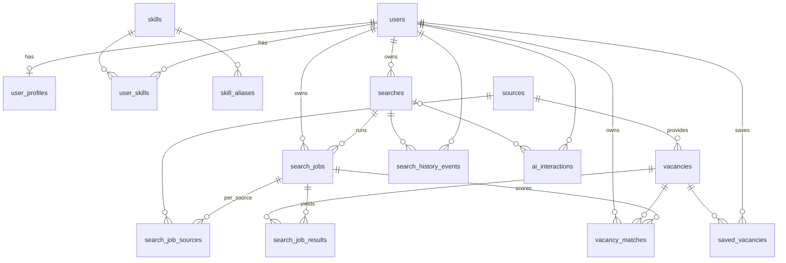

# Database Schema

PostgreSQL 16. The schema is owned by Alembic migrations in `backend/alembic/versions/`. ORM models live in `backend/app/models/`. This document describes the schema at revision **`0ab7835a44ff`** (`ff0fd9cabbe9` initial MVP schema, `af0f71f9d25c` user sessions, `008e13f9596a` search-run tracking, `0ab7835a44ff` auth events and password reset tokens).

Related: `architecture-plan.md` §7 (data architecture), TD-12 (idempotency), TD-13 (results), TD-14 (salary), TD-16 (dedup), TD-23 (storage policy), TD-24 (deletion), TD-26 (IDs).

## Conventions

| Topic | Rule |
|---|---|
| Primary keys | `uuid`, generated in the app as UUIDv7 (`app/core/ids.py`) for time ordering and index locality. Link tables use composite PKs. |
| Timestamps | `timestamptz` (UTC). `created_at` defaults to `now()`. `updated_at` defaults to `now()` and is refreshed by the ORM on every update. No triggers. |
| Enums | `text` + a CHECK constraint named `ck_<table>_<column>`, mirrored by a Python `StrEnum` in `app/core/enums.py`. The ORM type `StrEnumType` returns enum members. Adding a value means updating the enum and the CHECK in a migration. |
| JSON | `jsonb`. Lists default to `'[]'`, objects to `'{}'`. Shapes are validated by Pydantic, not the database. |
| Money | `numeric(12,2)` with an ISO 4217 currency code (`^[A-Z]{3}$`). Never floats. |
| Countries | ISO 3166-1 alpha-2 (`^[A-Z]{2}$`). |
| Unknown data | `NULL`. Vacancy fields a source didn't provide are never filled in or guessed (VACANCY-003). |
| Constraint names | Deterministic naming convention: `pk_`, `fk_<table>_<column>_<ref>`, `uq_`, `ix_`, `ck_`. |
| Foreign keys | Every FK has an index (enforced by `tests/unit/test_model_metadata.py`). User-owned rows use `ON DELETE CASCADE` from `users`. Shared rows use `RESTRICT`. |
| Relationships | ORM relationships are `lazy="raise"`: services must load related rows explicitly (`selectinload`). DB-level cascades are trusted (`passive_deletes=True`). |
| Extensions | `citext` (case-insensitive email), `pg_trgm` (fuzzy title dedup). Both are created by the initial migration. |

No business logic lives in the database. Constraints guard invariants that must never be violated, whichever code path writes the row.

## Entity-relationship overview



Shared data (not owned by any user): `skills`, `skill_aliases`, `sources`, `vacancies`.

## Tables

Columns marked **NN** are `NOT NULL`. Every table with `updated_at` also has `created_at`.

### users
Account identity. Login sessions live in `user_sessions`.

| Column | Type | Notes |
|---|---|---|
| id | uuid PK | |
| email | citext **NN** | UNIQUE (case-insensitive). ≤ 254 chars. |
| password_hash | text **NN** | Argon2id hash (TD-04). |
| is_verified, is_admin | boolean **NN** | Default `false`. |
| preferred_locale | text **NN** | Default `en`. Not CHECKed, so adding a locale needs no migration (TD-20). Set at registration, changed through `PATCH /settings`. |
| timezone | text **NN** | IANA name, default `UTC`. Set at registration, changed through `PATCH /settings`. |
| terms_version, privacy_version | text | Versions of the terms/privacy policy accepted at registration (`LEGAL_*_VERSION`, AUTH-002). |
| terms_accepted_at | timestamptz | |
| failed_login_count | integer **NN** | Default 0, ≥ 0. Failed logins in a row, counted atomically. Reset by a successful login, by a password reset, and when it reaches `LOGIN_LOCKOUT_THRESHOLD` (the account locks). |
| locked_until | timestamptz | Login lockout end (`LOGIN_LOCKOUT_DURATION` after the threshold is reached). Cleared by a successful login after it passes and by a password reset. |
| last_login_at | timestamptz | Set on registration and every successful login. |
| created_at, updated_at | timestamptz **NN** | |

### user_sessions
Server-side login sessions (TD-03). The cookie holds a random 256-bit token; only its SHA-256 is stored, so a database leak exposes no usable session.

| Column | Type | Notes |
|---|---|---|
| id | uuid PK | |
| user_id | uuid **NN** | FK `users` CASCADE. Indexed. |
| token_hash | text **NN** | UNIQUE. SHA-256 hex of the cookie token (64 chars). |
| last_seen_at | timestamptz **NN** | Last activity. The session ends after `SESSION_IDLE_TIMEOUT` (7 days) without activity. Written at most every `SESSION_TOUCH_INTERVAL` (5 min). |
| expires_at | timestamptz **NN** | Absolute end: login + 30 days with "remember me", 12 hours without. |
| user_agent | text | ≤ 512 chars. No IP address is stored. |
| created_at | timestamptz **NN** | |

A session is deleted on logout, on a login that replaces it (token rotation), and when it is found expired. A user's expired sessions are also removed at each login. A password change deletes all of the user's sessions and creates one new session for the browser that made the change; a password reset deletes them all. `created_at` is set by the application at login, so `expires_at - created_at` tells a "remember me" session from a browser session.

### auth_events
Append-only security log (AUTH-006): logins, failures, lockouts, rate-limit hits, password changes and resets. It never holds a raw email or IP address. Not exposed by the API.

| Column | Type | Notes |
|---|---|---|
| id | uuid PK | |
| user_id | uuid | FK `users` CASCADE. NULL when the email has no account (e.g. a failed login for an unknown email). Index `(user_id, created_at)`. |
| event_type | text **NN** | `login_succeeded \| login_failed \| account_locked \| rate_limited \| password_changed \| password_reset_requested \| password_reset`. |
| email_hash | text | Keyed hash (HMAC-SHA256 with `LOG_HASH_SECRET`, 16 hex chars) of the lower-cased email, to correlate attempts on one address. ≤ 64 chars. |
| ip_prefix | text | Client network, `/24` (IPv4) or `/48` (IPv6), e.g. `203.0.113.0/24`. ≤ 64 chars. |
| user_agent | text | ≤ 512 chars. |
| detail | text | Machine-readable reason: `unknown_account`, `wrong_password`, `account_locked` or `password_change` for `login_failed`; the limit name for `rate_limited`. ≤ 64 chars. |
| created_at | timestamptz **NN** | Indexed (retention, TD-24: 180 days). |

### password_reset_tokens
Single-use password reset links (AUTH-004). Like sessions, only the SHA-256 of the emailed token is stored.

| Column | Type | Notes |
|---|---|---|
| id | uuid PK | |
| user_id | uuid **NN** | FK `users` CASCADE. Indexed. |
| token_hash | text **NN** | UNIQUE. SHA-256 hex (64 chars, CHECKed). |
| expires_at | timestamptz **NN** | Request time + `PASSWORD_RESET_TOKEN_TTL` (30 min). |
| used_at | timestamptz | Set when the token is used. A token is claimed with one conditional `UPDATE` (unused and unexpired), so it works once even under concurrent requests. |
| created_at | timestamptz **NN** | |

A new reset request deletes the user's unused tokens, so only the newest link works. A successful reset deletes the remaining ones.

### user_profiles
One per user (`UNIQUE(user_id)`), created on the first `PATCH /profile` or the first consent change in `PATCH /settings` (`INSERT … ON CONFLICT DO NOTHING`, so concurrent first saves are safe). Professional data only. Sensitive attributes (age, gender, nationality, religion, health, marital status, photo) are deliberately absent (MATCH-004), and the API rejects them as unknown fields. The row also holds the two consent flags, which only the settings API changes: `DELETE /profile` resets every profile column to empty but keeps them. A row whose profile columns are all empty (created by a consent change, or cleared) reads as an empty profile (`updated_at: null`) and gives search runs no profile snapshot. `updated_at` also moves when a consent changes.

| Column | Type | Notes |
|---|---|---|
| id | uuid PK | |
| user_id | uuid **NN** | FK `users` CASCADE, UNIQUE. |
| display_name | text | |
| desired_roles | jsonb **NN** | `["python developer", …]`. |
| country | varchar(2) | ISO 3166-1 alpha-2. |
| region, city | text | City level only. Coordinates and IPs are never stored (LOCATION-004, TD-15). |
| location_source | text | `manual \| ip \| browser`. |
| salary_min, salary_max | numeric(12,2) | ≥ 0, `min ≤ max`. |
| salary_currency | varchar(3) | ISO 4217. |
| salary_period | text | `hour \| day \| month \| year \| unknown`. |
| work_formats | jsonb **NN** | Values of `remote \| hybrid \| onsite`. |
| employment_types | jsonb **NN** | Values of `full_time \| part_time \| contract \| internship \| temporary`. |
| experience_level | text | `intern \| junior \| middle \| senior \| lead`. |
| languages | jsonb **NN** | `[{"code": "en", "level": "C1"}, …]`. |
| relocation_ready | boolean **NN** | Default `false`. |
| summary | text | ≤ 5000 chars. Free-text professional summary (stands in for a CV in the MVP). |
| ai_use_profile | boolean **NN** | Default `true` (`DEFAULT_AI_USE_PROFILE`, also used when no row exists). Consent to use the profile in AI context (AMB-09). Copied into each search-run snapshot. |
| ai_use_history | boolean **NN** | Default `false` (`DEFAULT_AI_USE_HISTORY`). Consent to use search history in AI context. |
| created_at, updated_at | timestamptz **NN** | |

### skills
Curated skill dictionary (GAP-14). The source of truth is `backend/app/db/seed/skills.json` (~190 skills with EN/RU aliases); `python -m app.cli skills sync` loads it idempotently. Sync adds and renames skills and replaces aliases, but never deletes a skill (`user_skills` restricts it).

| Column | Type | Notes |
|---|---|---|
| id | uuid PK | |
| name | text **NN** | Display name. |
| normalized_name | text **NN** | UNIQUE. `normalize_skill()`: NFKC, case-folded, spaces collapsed, `ё` → `е`; punctuation kept (`c`, `c++`, `c#`).
| created_at | timestamptz **NN** | |

### skill_aliases
Synonyms for skill extraction and matching (e.g. `js` → JavaScript).

| Column | Type | Notes |
|---|---|---|
| alias_normalized | text PK | One alias maps to exactly one skill. |
| skill_id | uuid **NN** | FK `skills` CASCADE. Indexed. |
| locale | text | Optional locale of the alias. |
| created_at | timestamptz **NN** | |

### user_skills
PK `(user_id, skill_id)`.

| Column | Type | Notes |
|---|---|---|
| user_id | uuid **NN** | FK `users` CASCADE. |
| skill_id | uuid **NN** | FK `skills` RESTRICT. Indexed. |
| skill_level | text | `beginner \| intermediate \| advanced \| expert`. |
| years_experience | numeric(3,1) | 0–70. |
| created_at, updated_at | timestamptz **NN** | |

### sources
Job source registry (TD-08, TD-23). Sources are disabled, never deleted. Rows are created and refreshed from the code registry (`app/integrations/sources/registry.py`) by `python -m app.cli sources sync`, which never changes `is_enabled` or `compliance_reviewed_at`.

| Column | Type | Notes |
|---|---|---|
| id | uuid PK | |
| adapter_key | text **NN** | UNIQUE. Maps to the adapter class in the registry. |
| name, base_url | text **NN** | |
| source_type | text **NN** | `api \| rss \| ats`. |
| is_enabled | boolean **NN** | Default `false`. **CHECK: can be `true` only when `compliance_reviewed_at` is set.** |
| terms_url | text | |
| rate_limit | jsonb **NN** | Token-bucket settings for the adapter. |
| storage_policy | text **NN** | `full \| snippet \| none`, default `none` (the most restrictive). |
| retention_days | integer | > 0. |
| attribution_text | text | Required attribution shown in the UI (GAP-24). |
| compliance_reviewed_at | timestamptz | Set when the SRS §17 review is done. |
| compliance_notes | text | |
| created_at, updated_at | timestamptz **NN** | |

### vacancies
One job posting from one source. Written only by ingestion (`VacancyIngestService`), from records a source adapter has normalized, so the table never depends on a source's format. Cross-source duplicates are grouped, never merged (TD-16). Users read only the vacancies in their own search results or saved list.

| Column | Type | Notes |
|---|---|---|
| id | uuid PK | |
| source_id | uuid **NN** | FK `sources` RESTRICT. |
| external_id | text | The source's ID. **UNIQUE `(source_id, external_id)` where not null** (dedup step 1). |
| url, canonical_url | text **NN** | CHECK `^https?://`. `canonical_url` is indexed (dedup step 2). |
| title, normalized_title | text **NN** | `normalized_title` has a GIN trigram index (dedup step 4). |
| company | text | As published by the source. There is no companies table. |
| company_normalized | text | Normalized name for fuzzy dedup. |
| description | text | Stored only when the source's `storage_policy` is `full`. |
| description_snippet | text | ≤ 500 chars (`snippet` policy). |
| requirements, responsibilities, skills | jsonb **NN** | Lists. `skills` has a GIN index. |
| language | text | ISO 639-1 language of the posting. |
| salary_min, salary_max | numeric(12,2) | As published. ≥ 0, `min ≤ max`. |
| salary_currency | varchar(3) | ISO 4217. |
| salary_period | text | `hour \| day \| month \| year \| unknown`. |
| salary_raw | text | Original salary text. |
| salary_monthly_min_eur, salary_monthly_max_eur | numeric(12,2) | Approximate EUR/month for filtering and matching only (TD-14). `min ≤ max`. |
| country | varchar(2) | ISO 3166-1 alpha-2. |
| region, city, location_raw | text | |
| remote_type | text | `remote \| hybrid \| onsite`. |
| employment_type | text | `full_time \| part_time \| contract \| internship \| temporary`. |
| experience_level | text | `intern \| junior \| middle \| senior \| lead`. |
| published_at | timestamptz | |
| collected_at | timestamptz **NN** | Default `now()`. |
| last_verified_at | timestamptz | |
| content_hash | text **NN** | sha256 hex (64 chars) of the AMB-24 fields. Indexed (dedup step 3). |
| duplicate_group_id | uuid | Same value for cross-source duplicates. Indexed. |
| is_active | boolean **NN** | Default `true`. **CHECK `is_active = (removed_at IS NULL)`.** |
| removed_at | timestamptz | When the source reported the posting closed (GAP-21). |
| created_at, updated_at | timestamptz **NN** | |

### searches
A set of search parameters (`SearchParamsV1`, TD-10). Each run is a `search_jobs` row.

| Column | Type | Notes |
|---|---|---|
| id | uuid PK | |
| user_id | uuid **NN** | FK `users` CASCADE. |
| title | text | Display title. |
| original_text | text | Natural-language request (≤ 2000 chars). `NULL` for form searches. |
| normalized_params | jsonb **NN** | `SearchParamsV1`. |
| params_schema_version | smallint **NN** | Default 1, > 0. |
| channel | text **NN** | `form \| ai`. |
| status | text **NN** | `draft \| confirmed \| archived`, default `draft`. |
| created_at, updated_at | timestamptz **NN** | Index `(user_id, created_at DESC)`. |

### search_jobs
One asynchronous run of a search (SEARCH-006). The transition rules live in the backend job service (architecture §6.2), not the database.

| Column | Type | Notes |
|---|---|---|
| id | uuid PK | |
| search_id | uuid **NN** | FK `searches` CASCADE. Index `(search_id, created_at DESC)`. |
| user_id | uuid **NN** | FK `users` CASCADE. Denormalized for user-scoped queries and limits. |
| status | text **NN** | `pending \| running \| completed \| partially_completed \| failed \| cancelled`, default `pending`. |
| idempotency_key | text | **UNIQUE `(user_id, idempotency_key)`** (TD-12). |
| request_id | text | Correlation ID (TD-21). |
| context | jsonb **NN** | Snapshot at creation: `{params (SearchParamsV1), params_schema_version, profile}`. `profile` (architecture §6.3) is `null` without a profile, else `{desired_roles, skills [{name, level, years_experience}], experience_level, languages, salary, work_formats, employment_types, relocation_ready, location, ai_use_profile}`: no name or summary. The next run sees profile edits; a running one doesn't. |
| progress | jsonb **NN** | `{sources_total, sources_done, results_so_far}` (TD-25). |
| deadline_at | timestamptz **NN** | `created_at + SEARCH_JOB_DEADLINE_SECONDS` (default 120 s). |
| cancel_requested_at, started_at, finished_at | timestamptz | CHECK `finished_at ≥ started_at`. |
| error_code, error_message | text | `error_code`: `ALL_SOURCES_FAILED`, `NO_SOURCES_RAN`, or `DISPATCH_ERROR` when n8n could not be triggered (TD-09). |
| result_count | integer **NN** | Default 0, ≥ 0. |
| created_at, updated_at | timestamptz **NN** | |

Partial indexes `WHERE status IN ('pending','running')`: `ix_search_jobs_active_user_id` (active runs per user), `ix_search_jobs_active_deadline_at` (stuck-job sweeper) and the **unique** `uq_search_jobs_active_search_id` (at most one active run per search, even under concurrent requests). `ix_search_jobs_user_id_created_at` serves the runs-per-hour limit.

### search_job_sources
Per-source outcome of a job, used to decide `completed` vs `partially_completed`. PK `(search_job_id, source_id)`.

| Column | Type | Notes |
|---|---|---|
| search_job_id | uuid **NN** | FK `search_jobs` CASCADE. |
| source_id | uuid **NN** | FK `sources` RESTRICT. Indexed. |
| status | text **NN** | `pending \| running \| succeeded \| failed \| timed_out \| skipped`, default `pending`. |
| fetched_count | integer **NN** | Raw records the source returned. |
| stored_count | integer **NN** | Vacancies this source linked to the run (after filters and dedup). |
| error_code | text | Typed `SourceErrorCode` (e.g. `SOURCE_UNAVAILABLE`, `SOURCE_QUOTA_EXHAUSTED`, `SOURCE_DEADLINE_EXCEEDED`, `SOURCE_RUN_CANCELLED`, `SOURCE_NOT_RUN` when the run failed before starting). Never a raw message. |
| duration_ms | integer | ≥ 0. |
| attempts | smallint **NN** | Claims so far, ≥ 0. Also the fencing token: an outcome is stored only by the claim with the current attempt number. |
| started_at, finished_at | timestamptz | Claim time (a `running` row older than `SOURCE_RUN_LEASE_SECONDS` may be reclaimed) and outcome time. |
| filter_report | jsonb **NN** | Per requested filter: `{"mode": "source\|local\|unsupported", "excluded": n, "unverified": n}`. |
| created_at, updated_at | timestamptz **NN** | |

### search_job_results
Vacancies returned by a job, at most 200 per job (TD-13). PK `(search_job_id, vacancy_id)`, which also makes ingest idempotent.

| Column | Type | Notes |
|---|---|---|
| search_job_id | uuid **NN** | FK `search_jobs` CASCADE. Index `(search_job_id, rank)`. |
| vacancy_id | uuid **NN** | FK `vacancies` CASCADE. Indexed. |
| rank | integer **NN** | > 0. |
| match_score | numeric(5,4) | 0–1. Internal sort key, never shown to users (MATCH-003). |
| unverified_filters | jsonb **NN** | Requested filters this vacancy could not be checked against (default `[]`). |
| created_at | timestamptz **NN** | |

Rows are inserted in arrival order with `ON CONFLICT DO NOTHING`, so retries and re-sightings never duplicate a link.

### vacancy_matches
Deterministic match result per job and vacancy (TD-11). **UNIQUE `(search_job_id, vacancy_id)`**.

| Column | Type | Notes |
|---|---|---|
| id | uuid PK | |
| user_id | uuid **NN** | FK `users` CASCADE. Index `(user_id, vacancy_id, created_at DESC)` finds the latest match for compare (AMB-17). |
| search_job_id | uuid **NN** | FK `search_jobs` CASCADE. |
| vacancy_id | uuid **NN** | FK `vacancies` CASCADE. Indexed. |
| match_level | text **NN** | `high \| medium \| low`. |
| match_score | numeric(5,4) | 0–1, internal only. |
| factors | jsonb **NN** | `[{name, score, status, detail}]`. |
| matching_skills, missing_skills | jsonb **NN** | Lists. |
| explanation | text | Prose derived only from `factors`. |
| explanation_locale | text | |
| explanation_source | text | `template \| ai`. |
| algorithm_version | smallint **NN** | > 0. |
| created_at | timestamptz **NN** | |

### saved_vacancies
**UNIQUE `(user_id, vacancy_id)`** (SAVED-003).

| Column | Type | Notes |
|---|---|---|
| id | uuid PK | |
| user_id | uuid **NN** | FK `users` CASCADE. Index `(user_id, created_at DESC)`. |
| vacancy_id | uuid **NN** | FK `vacancies` **RESTRICT**: retention can never delete a saved vacancy. Indexed. |
| note | text | ≤ 2000 chars. |
| created_at, updated_at | timestamptz **NN** | |

### search_history_events

| Column | Type | Notes |
|---|---|---|
| id | uuid PK | |
| user_id | uuid **NN** | FK `users` CASCADE. Index `(user_id, created_at DESC)`. |
| search_id | uuid | FK `searches` CASCADE. Indexed. |
| event_type | text **NN** | `search_created \| search_confirmed \| search_run`. |
| metadata | jsonb **NN** | Small, non-sensitive event details. The ORM attribute is `event_metadata`, because `metadata` is reserved by SQLAlchemy. |
| created_at | timestamptz **NN** | |

### ai_interactions
Metadata of AI calls for cost, quota and quality tracking. **Prompt and response content is not stored** (SRS §7.12, CLAUDE.md §7). Written only by `AIService`, one row per call that reached the provider (retries and the repair turn included: tokens are summed); calls stopped by a quota, an open circuit or a missing provider leave no row. The rows of the last 24 h are the daily quota. `error_code` is an `AIErrorReason` (`provider_unavailable`, `provider_timeout`, `provider_rate_limited`, `provider_rejected`, `invalid_response`); `model` is `unknown` when the provider never answered. `cost_estimate_usd` stays empty until a provider with a price list is configured.

| Column | Type | Notes |
|---|---|---|
| id | uuid PK | |
| user_id | uuid **NN** | FK `users` CASCADE. Index `(user_id, created_at DESC)` for daily quotas. |
| search_id | uuid | FK `searches` **SET NULL**: usage records outlive a deleted search. Indexed. |
| task | text **NN** | `parse_query \| clarify \| explain_match`. |
| provider, model, prompt_version | text **NN** | |
| request_id | text | |
| status | text **NN** | `succeeded \| failed`. |
| error_code | text | |
| input_tokens, output_tokens, latency_ms | integer | ≥ 0. |
| cost_estimate_usd | numeric(10,6) | ≥ 0. |
| created_at | timestamptz **NN** | |

## Deletion semantics

| Action | Effect |
|---|---|
| Delete a user (AMB-14) | `DELETE FROM users` cascades to every user-owned table: sessions, auth events, reset tokens, profile, skills, searches, jobs, job sources, results, matches, saved vacancies, history events and AI interactions. Shared `vacancies`, `sources` and `skills` stay. |
| Delete one search | Cascades to its jobs → job sources, results, matches. Its history events are deleted. AI interactions keep their metrics with `search_id = NULL`. |
| Delete history (AMB-13) | The service deletes the user's searches (cascades as above), remaining history events and AI interactions. Saved vacancies are kept. |
| Vacancy retention (TD-24) | Deleting a vacancy cascades to job results and matches. It is **blocked** while any user has it saved. |
| Sources | Can't be deleted while vacancies or job runs reference them. Disable them instead. |

All of these are covered by `backend/tests/integration/db/test_cascades.py`.

## Scope decisions

The initial schema covers the SRS §1.3 MVP scope. Entities that were considered:

| Entity | Decision |
|---|---|
| Users | `users` + `user_profiles`. |
| Skills | `skills`, `skill_aliases`, `user_skills`. |
| Jobs (postings) | `vacancies`. The SRS and API call them vacancies. "Job" in this codebase means an asynchronous search run (`search_jobs`). |
| Job sources | `sources`. |
| Searches | `searches`, `search_jobs`, `search_job_sources`, `search_job_results`, `search_history_events`. |
| Job matches | `vacancy_matches`. |
| Saved jobs | `saved_vacancies`. |
| AI analyses | `ai_interactions` (call metadata) + `vacancy_matches.explanation` (the analysis output). No prompt/response content is stored. |
| Companies | **No table.** Sources provide free-text company names with no stable IDs. A companies table would need entity resolution, and no requirement needs company-level data. `vacancies.company` + `company_normalized` cover display, compare and dedup. |
| Resumes | **No table.** A CV builder is out of MVP scope (SRS §1.3) and no CV upload is specified. The professional data a resume would hold lives in `user_profiles` (summary, roles, experience, languages) and `user_skills`. |
| Applications | **No table.** Auto-apply is out of MVP scope (SRS §1.3), and application tracking isn't specified. |
| Notifications | **No table.** Explicitly "Won't (MVP)" (GAP-20). |

Tables from `architecture-plan.md` §7.2 that are **deferred** to the milestone that uses them:

| Table | Milestone |
|---|---|
| `email_verification_tokens` | M3.7 email verification |
| `fx_rates` | M5 salary normalization (TD-14) |
| `audit_log` | M11 account deletion |

## Migrations

```bash
cd backend
uv run alembic upgrade head                               # apply
uv run alembic revision --autogenerate -m "<message>"     # then review by hand
uv run alembic check                                      # fails if models and migrations differ
uv run alembic upgrade head --sql                         # offline SQL for review
```

- Autogenerate does not detect changes to CHECK constraints or extensions. Write those by hand.
- `alembic/env.py` renders `StrEnumType` columns as `sa.Text()`, so migrations never import app code.
- Never edit an applied migration. Add a new one.

## Tests

| Test | What it covers |
|---|---|
| `tests/unit/test_model_metadata.py` | No DB: expected table set, every FK indexed, user FKs cascade, every enum column has a CHECK, all timestamps are timezone-aware. |
| `tests/unit/test_ids.py` | UUIDv7 version, variant, timestamp and ordering. |
| `tests/integration/db/test_migrations.py` | Downgrade to base and upgrade again, models ↔ migrations drift, extensions installed. |
| `tests/integration/db/test_constraints.py` | Defaults, `updated_at`, case-insensitive email, enum and range CHECKs, the compliance gate, partial unique dedup key, idempotency key, saved-once rule. |
| `tests/integration/db/test_cascades.py` | The deletion semantics above. |

Database tests need `TEST_DATABASE_URL` (see `backend/.env.example`) and are skipped without it. The test database is **dropped and rebuilt from migrations** at the start of each run. Each test runs in a transaction that is rolled back.
