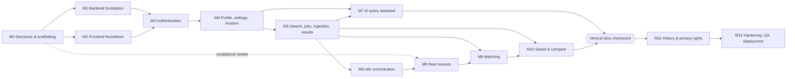

# Development Roadmap — AI Job Assistant (MVP)

| Field | Value |
|---|---|
| Based on | `SRS.md` §14 (reordered by dependency), `requirements-analysis.md` §20, `architecture-plan.md`, `technical-decisions.md` |
| Ordering rule | A milestone starts only when every milestone it depends on meets its exit criteria. Items marked ∥ can run in parallel. |
| Task format | Each task below becomes a Claude Code task in the SRS §13.3 format (goal, context, files, requirements, constraints, acceptance, verification commands) |

## Why the SRS §14 order was changed

| SRS order | Problem | New placement |
|---|---|---|
| Phase 1 Frontend skeleton before Phase 2 backend foundation and before the design and architecture are agreed | The UI would be built against unknown contracts and tokens | M2 runs ∥ with M1 after M0. The UI uses mock data only until the M3 contracts exist. |
| Phase 5 "mock source" without an adapter framework or vacancy model | The mock would be thrown away | M5 builds the real adapter framework + ingestion with a `MockSourceAdapter` |
| Phase 6 n8n before the ingestion/state logic exists | n8n would get business logic (CON-01) | M6 wires n8n to backend services that already exist and are tested |
| Phase 8 real sources before compliance review | Legal risk | Compliance review starts in M0 and runs ∥ with M1–M7. It gates M8. |
| Phase 9 matching after the pipeline that already calls a matching step | Pipeline change later | M5 finalize has a no-op matching hook. M9 fills it in. |
| Privacy rights (delete history/account, personalization) not in any phase | Missing from the MVP DoD | M11 |
| CI/CD "in the future" | Quality gates are needed from the first commit | M0 |

## Dependency graph

**Critical path:** M0 → M1 → M3 → M4 → M5 → M6 → M8 → M9 → M10 → M11 → M12.
**Parallel tracks:** M2 ∥ M1 · M7 ∥ M6/M8 (after M5) · source compliance ∥ M1–M7 · M10's saved-vacancies part can start after M5 (the compare "match" column waits for M9).

Relative sizing for planning (1 dev-week ≈ S=2–3 days, M=1 week, L=2 weeks). One full-stack developer with Claude Code: roughly 14–18 weeks to MVP.

---

## M0 — Decisions, compliance kick-off, scaffolding  *(size M)*
**Depends on:** nothing. **Blocks:** everything.

| # | Task | Output |
|---|---|---|
| M0.1 | Product-owner answers to the blocking questions (`requirements-analysis.md` §21) and approval of TD-06/TD-07 | Decisions recorded in `technical-decisions.md` (status → Accepted) |
| M0.2 | Source shortlist (3–5 candidates) + start the §17 compliance checklist for each | `docs/source-compliance.md` draft |
| M0.3 | Repo scaffold per `architecture-plan.md` §4.2/§5.2: `.gitignore`, `.editorconfig`, root `README.md`, `CLAUDE.md` (SRS §13.2 content), `PROJECT_SPEC.md` (condensed SRS + decisions), `.env.example` files | Scaffold committed |
| M0.4 | `docker-compose.yml`: postgres, redis, mailpit, n8n, n8n-db, caddy (app services added in M1/M2) | `docker compose up` starts the infrastructure |
| M0.5 | CI skeleton (GitHub Actions): path-filtered backend/frontend jobs, gitleaks, workflow-JSON credential check | Green pipeline on an empty project |
| M0.6 | Design: design tokens + low-fidelity wireframes for the critical screens (Figma or a token file if Figma isn't ready) | `frontend/styles/tokens.css` spec, screen list with states |
| M0.7 | Legal track started: privacy policy/terms drafts, jurisdiction list for review | Drafts (final legal review by M12) |

**Exit criteria:** blocking decisions recorded. Compose infrastructure boots. CI green. CLAUDE.md present. Compliance review is underway for at least 2 candidate sources.

---

## M1 — Backend foundation  *(size M)* ∥ M2
**Depends on:** M0.

| # | Task | Refs |
|---|---|---|
| M1.1 | FastAPI app factory, pydantic-settings config (per-env), uv project, ruff/mypy config | SRS §5.1 |
| M1.2 | Error catalog + global exception handlers → SRS error envelope with `request_id` | SRS §6, GAP-11, TD-19 |
| M1.3 | structlog JSON logging, request-ID middleware, access log, body size limit, security headers | TD-21, SRS §10 |
| M1.4 | Async SQLAlchemy session, Alembic setup, base model (UUIDv7, timestamps), `citext`/`pg_trgm` extensions migration | SRS §7, TD-26 |
| M1.5 | `/health` (liveness) and `/ready` (DB + Redis) | SRS §6 |
| M1.6 | Redis client + rate-limit utility (sliding window) | TD-18 |
| M1.7 | Test infrastructure: pytest, Postgres test DB (transaction rollback per test), factories, httpx client fixture; CI job | TD-22 |
| M1.8 | OpenAPI export script + CI artifact | TD-19 |
| M1.9 | Backend Dockerfile + compose service, `make migrate` | TD-17 |

**Exit criteria:** `docker compose up` → `/ready` 200. `pytest` and `ruff`/`mypy` are green in CI. An example error returns the envelope. Migrations run from zero.
**Verify:** `uv run pytest`, `uv run ruff check .`, `uv run mypy app`, `alembic upgrade head`.

---

## M2 — Frontend foundation  *(size M)* ∥ M1
**Depends on:** M0 (tokens, route list).

| # | Task | Refs |
|---|---|---|
| M2.1 | Next.js (App Router, TS strict), pnpm, ESLint/Prettier, Tailwind + tokens, shadcn/ui init | SRS §5.1, §9.5 |
| M2.2 | next-intl with `/[locale]` routing, EN/RU catalogs, locale switcher, `Intl` format helpers, lint rule against hard-coded strings | TD-20, NFR-11 |
| M2.3 | App shell: header/nav, responsive layout (360 px+), footer with legal links, skip-link, focus styles | SRS §4.4 |
| M2.4 | Shared state components: Loading, Empty, Error, Offline, with RateLimited variants | SRS §9.4 |
| M2.5 | API client (openapi-fetch + generated types + CSRF header + error-code → i18n message mapping); TanStack Query provider | TD-19 |
| M2.6 | Landing page (static + query box that stores to sessionStorage) | SRS §9.3, AMB-01 |
| M2.7 | Auth page UIs (register, login, forgot, reset) wired to MSW mocks | SRS §9.3 |
| M2.8 | Vitest + RTL + MSW setup, Playwright setup with axe, CI job (lint, typecheck, test, build) | TD-22 |
| M2.9 | Frontend Dockerfile (standalone output) + compose service + Next rewrite `/api/v1` → backend | TD-05 |

**Exit criteria:** landing and auth pages render in EN/RU, pass axe with no serious violations, and are responsive. CI builds. The rewrite reaches the backend `/health` through Next.

---

## M3 — Authentication  *(size M)*
**Depends on:** M1, M2.

| # | Task | Refs |
|---|---|---|
| M3.1 | Models + migration: `users` (extended), `user_sessions`, `password_reset_tokens`, `email_verification_tokens`, `auth_events`, `audit_log` | §7.2 |
| M3.2 | Argon2id hashing service with rehash-on-login | AUTH-003, TD-04 |
| M3.3 | Register (validation, consent version stored, duplicate rejection), login (session creation, token rotation), logout, logout-all, me | AUTH-001/002/004 |
| M3.4 | Session dependency, CSRF double-submit, cookie settings per env | TD-03 |
| M3.5 | Rate limits and progressive lockout on login/register/forgot, `auth_events` logging | AUTH-006 |
| M3.6 | Forgot/reset password (single-use hashed token, 30 min TTL, revoke sessions), change password; EmailSender + Mailpit + EN/RU templates | AUTH-004, TD-27 |
| M3.7 | Email verification (non-blocking) | AMB-02 |
| M3.8 | Frontend: wire the auth pages to the real API, `middleware.ts` guard, `(app)` layout with `/me`, session-expired handling, restore the landing query after signup | F1, F2 |
| M3.9 | Tests: unit (hashing, tokens), API (all acceptance criteria), **authz matrix harness** (reusable for later milestones), E2E register→logout | SRS §11.1 |

**Exit criteria:** all AUTH acceptance criteria pass. Protected endpoints return 401 without a session. The generic login error is verified. The reset email arrives in Mailpit. The E2E auth flow passes in CI.

---

## M4 — Profile, settings, location  *(size M)*
**Depends on:** M3.

| # | Task | Refs |
|---|---|---|
| M4.1 | Models + migration: `user_profiles` (extended), `skills`, `skill_aliases`, `user_skills`; seed skills dictionary EN/RU | PROFILE-001, GAP-14 |
| M4.2 | `GET/PATCH /profile`, `GET/PUT /profile/skills`, `DELETE /profile`; validation (salary min ≤ max, ISO currency/country, enums) | PROFILE-001..002 |
| M4.3 | `GET/PATCH /settings` (locale, timezone, ai_use_profile, ai_use_history), `GET /settings/personalization` | PROFILE-003/004, GAP-02 |
| M4.4 | GeoIP integration (local DB, loader, trusted-proxy IP extraction), `GET /location/estimate`, `PATCH /location/preference`, `POST /location/resolve` (offline reverse geocode) | LOCATION-001..005, TD-15 |
| M4.5 | Location priority resolver (CON-10) as a service function for M5 | CON-10 |
| M4.6 | Frontend: onboarding + profile page (skills autocomplete from the dictionary), settings/personalization page, location chip with confidence + edit dialog | F3, F10 |
| M4.7 | Tests: validation, authz matrix entries, GeoIP edge cases (private IP, VPN-like low confidence, missing DB) | SRS §11 |

**Exit criteria:** PROFILE acceptance passes (saved, editable, deletable, validated). Location is estimated and editable, and no IPs are persisted (verified by test). Personalization panel shows the fields used.

---

## M5 — Search, jobs, ingestion, results (mock source)  *(size L)*
**Depends on:** M4. This is the core domain milestone.

| # | Task | Refs |
|---|---|---|
| M5.1 | `SearchParamsV1` Pydantic schema + enums, exported to OpenAPI/TS | TD-10 |
| M5.2 | Models + migration: `searches`, `search_jobs`, `search_job_sources`, `search_job_results`, `sources`, `vacancies`, `vacancy_matches` (table only), `search_history_events` | §7.2 |
| M5.3 | `POST/GET /searches`, `GET/DELETE /searches/{id}`, validation (role required, salary rules) | SEARCH-001..005 |
| M5.4 | Job service: state machine, context snapshot, idempotency key, per-user limits, cancel, deadline + lazy sweep | SEARCH-006, TD-12, §6.2 |
| M5.5 | `JobDispatcher` interface + `InlineDispatcher` | TD-09 |
| M5.6 | Source adapter framework (protocol, registry, compliance gate, Redis token bucket, honest User-Agent) + `MockSourceAdapter` with edge-case fixtures | SOURCE-001, TD-08 |
| M5.7 | Normalization pipeline (HTML sanitize, title/company/location/remote/salary parsing, dictionary skill extraction, language detect, canonical URL, content hash) | §3.7, TD-14, AMB-24 |
| M5.8 | Ingest service: validate → dedup (TD-16) → upsert → link to job; per-source status; storage policy enforcement | VACANCY-001..004, SOURCE-002/003, TD-23 |
| M5.9 | Finalize: terminal status rules (AMB-23), result count, **matching hook (no-op until M9)** | §6.1 |
| M5.10 | Endpoints: `POST /searches/{id}/run`, `GET /searches/{id}/jobs`, `GET /search-jobs/{id}` (progress, ETag), `POST /search-jobs/{id}/cancel`, `GET /search-jobs/{id}/results` (filters, sort by date/salary, cursor), `GET /vacancies/{id}`, `GET /vacancies` | TD-13, TD-25 |
| M5.11 | FX rates table + manual refresh command (Cron comes in M6) | TD-14 |
| M5.12 | Frontend: form search → review screen → confirm → job progress (polling, per-source status, cancel) → results list/table with filters/sorting → vacancy detail (source attribution, original link, fetched date, freshness warning, "Not specified" salary) | F4, F6, SOURCE-004, VACANCY-003 |
| M5.13 | Tests: state machine, idempotency (double run, replayed ingest), dedup fixtures, normalization snapshots, partial failure (mock adapter configured to fail/time out), authz entries | SRS §11.1 |

**Exit criteria:** a user can run a form search end to end with the inline dispatcher and the mock source. Repeated clicks don't create duplicate jobs. A simulated source failure gives `partially_completed`. Re-ingest creates no duplicate vacancies. Results show source, link and fetch date.

---

## M6 — n8n orchestration  *(size M)*
**Depends on:** M5.

| # | Task | Refs |
|---|---|---|
| M6.1 | Internal API `/internal/v1` (context, status, source run, finalize, maintenance) + service-token/HMAC/timestamp auth + network restriction | GAP-09, §8.3 |
| M6.2 | `N8nDispatcher` (signed webhook call, dispatch failure → job `failed` with `DISPATCH_ERROR`) | TD-09 |
| M6.3 | WF-001 Search Request: webhook → verify signature (Code node, shared secret from credentials) → fetch context → status running → execute WF-002 per source in parallel → collect → finalize → Error Trigger → report failure | SRS §8.1 (revised per TD-06) |
| M6.4 | WF-002 Source Search: call source-run endpoint with timeout, retry (1× on 5xx/timeouts), map outcome, stop on 410 | SRS §8.2 |
| M6.5 | Cron workflows: sweep-jobs (1 min), refresh-fx (daily), retention (daily), reverify-saved (daily, enabled in M10) | TD-06, NFR-07 |
| M6.6 | Workflow export/import scripts, JSON in `n8n/workflows/`, `n8n/README.md` (setup, credentials to create, env vars), CI check for embedded credentials | SRS §8.6 |
| M6.7 | Integration test suite in compose (SRS §11.3 cases): valid webhook, bad signature, source timeout, empty result, duplicates, partial failure, re-run, rate limit exceeded | SRS §11.3 |

**Exit criteria:** with `JOB_DISPATCHER=n8n`, the M5 flow works unchanged. All §11.3 cases pass (the "AI error" case is covered in M7/M9). Killing n8n mid-job → the job is finalized by the deadline sweep. Workflows import cleanly into a fresh n8n.

---

## M7 — AI query assistant  *(size M)* ∥ M6/M8
**Depends on:** M4 (profile, settings), M5 (`SearchParamsV1`, searches). The provider decision comes from M0.

| # | Task | Refs |
|---|---|---|
| M7.1 | `LLMProvider` interface + first provider implementation, config-driven model tiers, timeout/retry/circuit breaker | TD-07 |
| M7.2 | Prompt templates (parse, clarify) versioned; `AIQueryResult` schema; structured-output call; repair retry | AI-001, AI-005, AI-007 |
| M7.3 | Guards: grounding checks for skills and salary, enum normalization, max 3 clarification rounds, locale enforcement | AI-002, AI-004 |
| M7.4 | Context builder respecting `ai_use_profile`/`ai_use_history` | AI-003, PROFILE-003 |
| M7.5 | `POST /ai/parse-query`, `/ai/clarify`, `/ai/confirm-query`; AI rate limits + daily quota; parse cache | TD-07, GAP-07 |
| M7.6 | `ai_interactions` logging (tokens, latency, status, prompt_version, cost estimate), no content by default | SRS §7.12 |
| M7.7 | Deterministic fallback extractor (roles/skills dictionaries) for AI outages | §9 |
| M7.8 | Frontend AI chat: messages, extracted-params card (editable), question chips, warnings, confirm → job progress; fallback to the form with text preserved | F5, SRS §9.3 |
| M7.9 | Evaluation set (≥ 40 EN/RU queries) with recorded responses in CI + live eval script; hallucination assertions | RISK-04 |

**Exit criteria:** SRS §11.4 steps 4–7 work through the AI chat. Invalid AI output never reaches the DB (tests). Ungrounded skills are dropped with a warning. AI outage → form fallback. The API key is never present in frontend bundles (CI grep check).

---

## M8 — Real sources  *(size M per source; first source is L)*
**Depends on:** M6 (orchestration), plus a **completed compliance review** for the source (started in M0).

| # | Task | Refs |
|---|---|---|
| M8.1 | Finish the compliance record for source #1: API terms, eligibility, rate limits, storage/display/attribution, caching, OAuth; set `storage_policy`, `retention_days`, `attribution_text` | SRS §17, TD-23 |
| M8.2 | Adapter #1: param mapping + capability flags, pagination within caps, error mapping (auth/rate-limit/5xx/timeout), recorded fixtures | SOURCE-001/002 |
| M8.3 | URL validation (scheme allow-list, canonicalization) and attribution rendering in the UI | Phase 8 SRS, GAP-24 |
| M8.4 | Source status surfacing: per-source badges in the job progress view, partial-result banner | SOURCE-004 |
| M8.5 | Admin CLI: `sources list/enable/disable`, `sources health` (recent error rates) | GAP-01 |
| M8.6 | Repeat M8.1–M8.2 for sources #2 and #3 (each independently shippable) | SRS §3.6 |

**Exit criteria:** a live search on staging returns real vacancies from source #1 with correct links, attribution and dedup. Disabling the source via CLI removes it from new jobs. Source outage → partial results.

### ◆ Vertical slice checkpoint (after M7 + M8.1–M8.4)
Registration → Profile → AI query → clarification → n8n → one real source → normalization → results. This is the SRS §18 slice minus save/compare. **Demo to the product owner. Adjust scope before continuing.**

---

## M9 — Matching  *(size M)*
**Depends on:** M5 (finalize hook, vacancies), M4 (profile), preferably M8 (real data to calibrate on).

| # | Task | Refs |
|---|---|---|
| M9.1 | Pure scoring functions per factor + weights/thresholds v1 + hard caps; unknown data handled as neutral | MATCH-001, TD-11 |
| M9.2 | Match service in finalize: compute for all job results, persist `vacancy_matches` idempotently, store internal score in `search_job_results` | MATCH-002 |
| M9.3 | Localized template explanations per factor status | MATCH-002, TD-20 |
| M9.4 | Optional AI explanation polish (top 20 / on demand via `GET /vacancies/{id}/match`), validated, template fallback; AI error handled | TD-11, AI-008 |
| M9.5 | Sort by match in the results API; level filter | MATCH-005, TD-13 |
| M9.6 | Frontend: MatchBadge (High/Medium/Low, no %), factor breakdown on detail, matching/missing skills chips, advisory disclaimer | MATCH-003, AI-008 |
| M9.7 | Calibration: label ~50 real vacancy/profile pairs, tune weights, record `algorithm_version` | AMB-06 |
| M9.8 | Tests: factor unit tests, sensitive-attribute exclusion test (scorer input schema), explanation grounding test | MATCH-004 |

**Exit criteria:** every result has a level + reasons. No percentage appears anywhere in the UI or public API. Explanations mention only computed factors. User sorting works.

---

## M10 — Saved vacancies & compare  *(size M)*
**Depends on:** M5 (vacancies). The compare match column depends on M9. *Saved-vacancies tasks M10.1–M10.3 may start right after M5.*

| # | Task | Refs |
|---|---|---|
| M10.1 | `saved_vacancies` migration (+updated_at); save/unsave (idempotent, unique), list with filters, `PATCH` note | SAVED-001..004 |
| M10.2 | Removed/stale handling for saved items; enable the reverify-saved Cron | GAP-21, AMB-12 |
| M10.3 | Frontend: save buttons (optimistic), Saved page with notes, filters, delete | F7 |
| M10.4 | `POST /vacancies/compare` (2–5 IDs, visible-to-user check, latest match or on-demand profile match) | COMPARE-001..003, AMB-17 |
| M10.5 | Frontend: compare selection tray (URL state), compare table with difference highlighting, "No data" cells, no winner | COMPARE-002..004 |
| M10.6 | Dashboard: last search, saved vacancies, quick search, profile hints, unfinished jobs | SRS §9.3 |
| M10.7 | Tests: duplicate save, foreign vacancy save/compare (authz), 1 and 6 IDs rejected, E2E §11.4 steps 9–12 | SRS §11 |

**Exit criteria:** the full SRS §11.4 E2E scenario passes locally and in CI (with the mock source).

---

## M11 — History & privacy rights  *(size S–M)*
**Depends on:** M10 (all user-owned data exists).

| # | Task | Refs |
|---|---|---|
| M11.1 | History page: list of searches with their latest job, re-run, delete one | F8 |
| M11.2 | `DELETE /history` scoped per AMB-13; `ai_use_history` respected in M7 context (verify) | SRS §10, AMB-13 |
| M11.3 | `DELETE /account` with password re-auth, cascade, session revoke, anonymized audit entry | SRS §10, TD-24 |
| M11.4 | Retention service (AI metadata, auth events, orphan vacancies, expired tokens) behind the retention Cron | GAP-06, TD-24 |
| M11.5 | Data export `GET /account/export` (JSON) — if approved in M0 | GAP-27 |
| M11.6 | Privacy UX: "what we collect" page linked from settings, cookie information notice, consent re-prompt when the terms version changes | SRS §10, GAP-05, GAP-29 |
| M11.7 | Tests: deletion leaves no user rows (query every user-owned table), history toggle effect, retention job | SRS §11.1 |

**Exit criteria:** all SRS §10 user rights work and are tested.

---

## M12 — Hardening, QA, deployment  *(size L)*
**Depends on:** M11 (feature complete).

| # | Task | Refs |
|---|---|---|
| M12.1 | Full E2E suite on staging (desktop + mobile viewport), a11y audit (axe + manual keyboard/screen-reader pass on critical flows) | SRS §11.2, §11.4, NFR-10 |
| M12.2 | Security review: authz matrix complete, OWASP ASVS L1 checklist, dependency audit, secret scan, CSP verification, HMAC replay test, rate-limit tests | SRS §10, NFR-12 |
| M12.3 | Performance: k6 smoke for CRUD p95, polling, and ingest; query plan review for hot queries; confirm NFR-01..05 | SRS §4.1 |
| M12.4 | Observability: Sentry FE/BE, metrics endpoint, dashboards, alerts (§15), centralized logs | TD-21, SRS §5.1 |
| M12.5 | Production infrastructure: VM/managed DB provisioning, Caddy HTTPS/HSTS, secrets, image registry, deploy pipeline with migration step and smoke test, staging parity | TD-17 |
| M12.6 | Backups for app DB and n8n DB (encrypted, offsite, 30 days) + **restore drill** documented | NFR-09, GAP-17 |
| M12.7 | Documentation: README (run from scratch), `docs/architecture.md`, `api.md`, `database.md`, `security.md`, `privacy.md`, `source-compliance.md` (SRS §12), runbook (incidents, source disable, key rotation) | SRS §11.5 |
| M12.8 | Legal sign-off on privacy policy/terms for the launch jurisdictions; launch geography decision | SRS §10, RISK-11 |
| M12.9 | MVP acceptance review against SRS §11.5 and §16 checklists | SRS §16 |

**Exit criteria (= MVP Definition of Done, SRS §16):** every item in SRS §11.5 and §16 is checked off. The restore drill succeeded. Alerts are live. Legal sign-off obtained.

---

## Cross-milestone rules (Definition of Done per task, from SRS §16)
- Implemented to the referenced requirement IDs. Validation and error handling included.
- Tests for critical logic. Authz matrix updated for every new user-scoped endpoint.
- `ruff`, `mypy`, `pytest` / `pnpm lint`, `typecheck`, `test`, `build` all pass. OpenAPI types regenerated with no drift.
- No secrets. `.env.example` updated. Migrations included and reversible where practical.
- UI: EN + RU strings, responsive, keyboard accessible, all states (loading/empty/error/…) present.
- Docs updated. The Claude Code report lists changed files and remaining risks (SRS §13.1).

## Milestone risk watchlist
| Milestone | Top risk | Early signal | Response |
|---|---|---|---|
| M0/M8 | No approvable source for the target regions (RISK-01) | Compliance review stalls by the end of M4 | Start with global remote/aggregator sources. Communicate coverage honestly in the UI. |
| M3 | Cookie/SSR auth issues (RISK-06) | E2E auth flakiness | Enforce the TD-05 same-site topology. Test SSR `/me` early. |
| M6 | n8n friction (RISK-03) | Workflow changes need backend changes often | Keep workflows generic. The inline dispatcher remains the fallback. |
| M7/M9 | AI cost or quality (RISK-04/05) | Eval accuracy < 85 %, cost per search > target | Tighten prompts and schemas. Move more to deterministic parsing. Lower the explanation N. |
| M12 | Legal review delays launch (RISK-11) | No reviewer assigned by M8 | Restrict launch geography. Soft-launch with invited users. |
