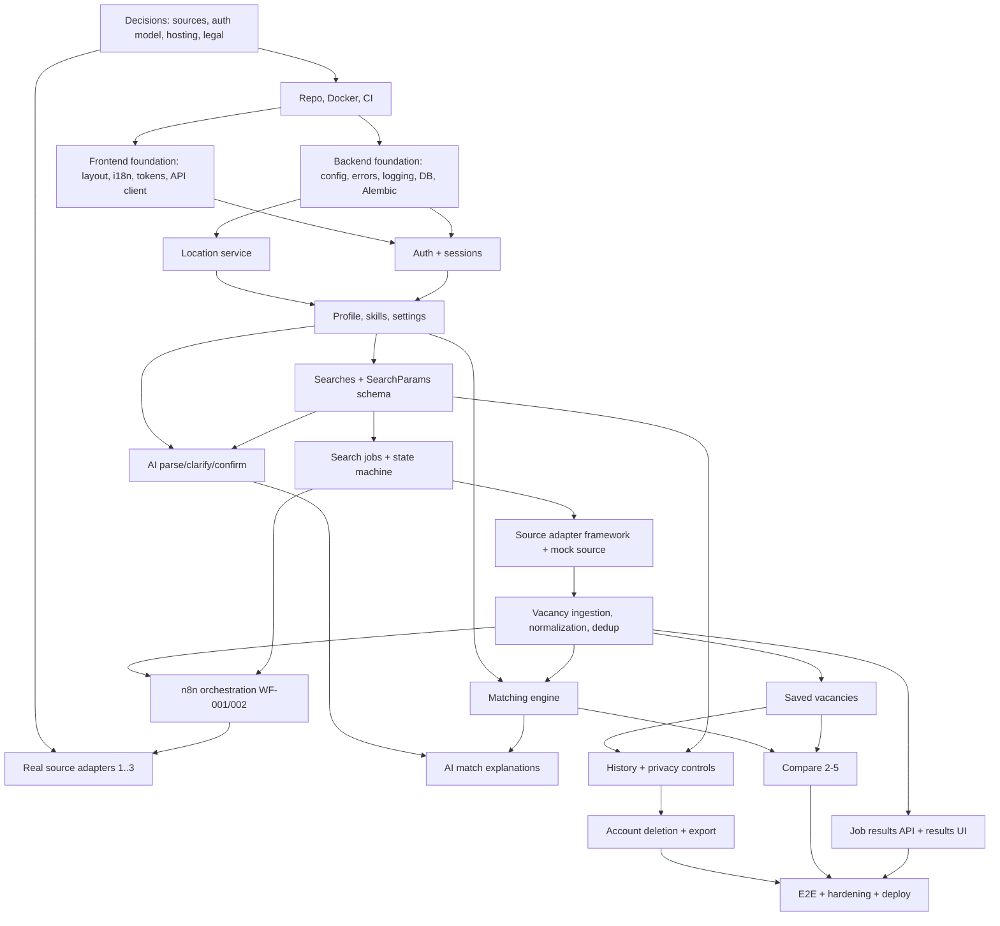

# Requirements Analysis — AI Job Assistant

| Field | Value |
|---|---|
| Source document | `docs/SRS.md` v1.0 (MVP, 17.09.2026, Russian) |
| Analysis date | 2026-09-27 |
| Status | Draft for product-owner review |
| Related | `architecture-plan.md`, `technical-decisions.md`, `development-roadmap.md` |

This document breaks down the SRS and lists its ambiguities, contradictions, gaps, risks and feature dependencies. SRS requirement IDs (e.g. `AUTH-001`) are kept. New findings use these prefixes:

| Prefix | Meaning |
|---|---|
| `AMB-xx` | Ambiguity: the requirement allows more than one reading |
| `CON-xx` | Contradiction: two parts of the SRS conflict |
| `GAP-xx` | Missing requirement |
| `RISK-xx` | Technical or delivery risk |
| `NFR-xx` | Proposed measurable non-functional target |
| `TD-xx` | Technical decision (see `technical-decisions.md`) |

---

## 1. Product Requirements

### 1.1 Vision
AI Job Assistant is an international web service. It turns a free-text job wish ("remote junior Python job in Vilnius, around 800 EUR") into a structured search. It collects vacancies only from permitted external sources, normalizes and de-duplicates them, explains how well each one fits the user's profile, and lets the user save and compare vacancies.

### 1.2 MVP scope (SRS §1.3)
**In scope:** registration/login/account area, user profile, AI help building the query, search through permitted sources, vacancy normalization and filtering, approximate location, saved vacancies, comparison (2–5), search history.

**Out of scope:** auto-apply, mailbox monitoring, auto-replies to employers, full CV builder, payments, mobile app, a complex ML recommender, and any bypassing of CAPTCHA, auth or rate limits.

### 1.3 Target audience and languages
Students, interns, juniors, experienced specialists, remote-work seekers and career changers, worldwide. UI languages in the MVP: **English and Russian**. Adding more languages must not require re-architecture (SRS §1.5, §4.5).

### 1.4 MVP success criteria (SRS §16, condensed)
The user can register, fill in a profile and create an AI search. The system asks clarifying questions, runs the search through n8n, and gets vacancies from permitted sources. Vacancies are normalized, de-duplicated and displayed. The user can save vacancies and compare 2–5 of them. Location is estimated and can be edited. User data is isolated. The project starts from the README.

### 1.5 Guiding principle
Build one thin, stable **vertical slice** first (SRS §18): Registration → Profile → Query → AI clarification → n8n → one permitted source → Normalization → Results → Save → Compare. Add more sources and features only after this path works.

---

## 2. Functional Requirements

Priority uses MoSCoW for the MVP. "Completeness" says whether the requirement can be built as written.

### 2.1 AUTH — Registration and authentication
| ID | Summary | Priority | Completeness / notes |
|---|---|---|---|
| AUTH-001 | Register with email and password | Must | OK |
| AUTH-002 | Validate email format, minimum password length, unique email, consent to privacy policy and terms | Must | Minimum length not given (propose ≥ 10 chars, max 128, check against a breached-password list is optional). Consent must be **stored with a version** (GAP-05). |
| AUTH-003 | Argon2id or bcrypt | Must | Pick Argon2id (TD-04). |
| AUTH-004 | Login, logout, current user, **change password**, password reset request | Must | "Change password" has **no endpoint** in §6 (GAP-02). Reset needs email delivery (GAP-04). |
| AUTH-005 | No cross-user data access | Must | Needs object-level checks everywhere (see §13). |
| AUTH-006 | Rate limiting, secure cookies or short-lived tokens, brute-force protection, logging of suspicious logins | Must | The token model is left open (CON-12 → TD-03). Needs a place to store login attempts and audit events (GAP-03). |

### 2.2 PROFILE
| ID | Summary | Priority | Notes |
|---|---|---|---|
| PROFILE-001 | Name, country, city/region, desired positions, salary min/max, currency, work format, employment type, experience level, skills, languages, relocation | Must | **Desired positions** and **languages** are missing from `user_profiles` (CON-15, GAP-03). Salary period is missing (AMB-04). |
| PROFILE-002 | Edit at any time | Must | OK |
| PROFILE-003 | AI uses only the profile data the user has allowed | Must | There is no model for granular consent (AMB-09). |
| PROFILE-004 | User sees which data is used for personalization | Must | Needs a "Personalization" panel and a settings endpoint (GAP-02). |
| Acceptance | "Required fields are validated" | — | No profile field is marked as required (AMB-25). |

### 2.3 SEARCH
| ID | Summary | Priority | Notes |
|---|---|---|---|
| SEARCH-001 | Create a query with a form or AI chat | Must | Both paths must produce the same canonical `SearchParams` schema (TD-10). |
| SEARCH-002 | 15 parameters (title, keywords, salary, currency, country, city, radius, format, level, type, skills, vacancy language, publish date, relocation) | Must/Should | Radius is hard to support (AMB-05). Vacancy language is not stored on vacancies (CON-15). |
| SEARCH-003 | Title is required | Must | The AI example uses `roles[]` (a list). Rule: at least one role. |
| SEARCH-004/005 | Show final parameters, allow edits before confirming | Must | OK |
| SEARCH-006 | Asynchronous job, `job_id`, statuses pending/running/completed/partially_completed/failed/cancelled | Must | The criteria for `partially_completed` are not defined (AMB-23). Cancellation semantics are missing (GAP-22). |
| Acceptance | "A repeated request does not create an uncontrolled number of jobs" | Must | Needs idempotency keys and per-user concurrency limits (GAP-23, TD-12). |

### 2.4 AI-CHAT
| ID | Summary | Priority | Notes |
|---|---|---|---|
| AI-001 | Natural language → structured JSON | Must | The JSON example ≠ SEARCH-002 fields (no keywords, radius, language, publish date). One canonical schema is needed (TD-10). |
| AI-002 | Ask only about parameters that are really missing or ambiguous | Must | "Missing" is not defined when only the title is required (AMB-08). A maximum number of rounds is needed. |
| AI-003 | Consider profile, prior searches (if allowed), current params, locale | Must | Needs a consent flag for using history (GAP-03). |
| AI-004 | Never invent skills, experience, salary, employers, vacancies, requirements | Must | Needs post-validation guardrails, not just prompt wording (see §9). |
| AI-005 | Return params, questions, warnings, short explanation | Must | OK |
| AI-006 | Keys stay out of the browser; call through the backend or n8n credentials | Must | Where the call runs is left open (CON-03 → TD-07). |
| AI-007 | Server-side schema validation (Pydantic/Zod) | Must | OK |
| AI-008 | The score is advisory | Must | Needs UI copy and a disclaimer. |

### 2.5 LOCATION
| ID | Summary | Priority | Notes |
|---|---|---|---|
| LOCATION-001 | Estimate the region without asking in the chat. Priority: saved → IP → manual | Must | The order is questionable: a manual override during a search should win (CON-10). |
| LOCATION-002 | Show the location and allow editing | Must | OK |
| LOCATION-003 | Precise browser location only with explicit permission | Could | Optional in the MVP. |
| LOCATION-004 | Don't store coordinates when a city is enough | Must | Don't store raw IPs either (TD-15). |
| LOCATION-005 | Handle VPN, proxy, mobile network, inaccurate IP data, denied permission | Must | Show a confidence level. Handle `X-Forwarded-For` behind the proxy. |

### 2.6 SOURCES
| ID | Summary | Priority | Notes |
|---|---|---|---|
| SOURCE-001 | One adapter per source: `search/normalize/validate/get_source_name/get_rate_limits` | Must | This is a code-level interface, but WF-002 puts the per-source logic in n8n (CON-02 → TD-08). |
| SOURCE-002 | Handle missing salary or date, multiple currencies, duplicates, removed postings, incomplete text, source outages | Must | Removed postings need a re-verification process, which is not specified (AMB-12). |
| SOURCE-003 | No CAPTCHA bypass or hiding identity; follow site terms; minimize stored data; no full-text copying without a legal basis | Must | This conflicts with storing `description` (CON-06). |
| SOURCE-004 | Show source name, original link, fetch date, freshness warning | Must | Per-source attribution rules may also apply (GAP-24). |

### 2.7 VACANCIES
| ID | Summary | Priority | Notes |
|---|---|---|---|
| (fields) | 20 normalized fields | Must | Missing: `salary_period`, `language`, `region`, `location_raw`, `salary_raw` (GAP-03). |
| VACANCY-001 | Dedup by source+external_id, canonical URL, content_hash, title+company+location | Must | Cross-source duplicates: merge or group? (AMB-10). The fields in the hash are not defined (AMB-24). |
| VACANCY-002 | Keep the original URL | Must | OK |
| VACANCY-003 | Missing salary → "Not specified", never estimated | Must | OK. i18n key. |
| VACANCY-004 | Mark stale vacancies and unavailable sources | Must | "Stale" is not defined (AMB-11). |

### 2.8 MATCHING
| ID | Summary | Priority | Notes |
|---|---|---|---|
| MATCH-001 | Factors: title, skills, level, salary, location, format, type, language, freshness | Must | No weights or thresholds (AMB-06). Salary comparison across currencies and periods (AMB-04). |
| MATCH-002 | Level, matching skills, missing skills, reasons, caveats | Must | OK |
| MATCH-003 | High/Medium/Low, no probability percentage | Must | `match_score_optional` stays internal (CON-11). |
| MATCH-004 | No sensitive personal data in ranking | Must | "Sensitive" is not listed (AMB-16). |
| MATCH-005 | User can sort | Must | Server-side vs client-side sorting (AMB-18). |

### 2.9 SAVED
| ID | Summary | Priority | Notes |
|---|---|---|---|
| SAVED-001..002 | Save, unsave, note, open original, see save date | Must | There is **no endpoint to edit a note** (GAP-02). |
| SAVED-003 | No duplicate save "in one collection" | Must | There are no collections in the schema (CON-07). |
| SAVED-004 | Owner-only | Must | OK |

### 2.10 COMPARE
| ID | Summary | Priority | Notes |
|---|---|---|---|
| COMPARE-001 | Choose 2–5 vacancies | Must | Validate on both client and server. |
| COMPARE-002 | 10 attributes, including match with profile | Must | Which match applies when vacancies come from different searches? (AMB-17). |
| COMPARE-003 | Missing → "No data" | Must | OK |
| COMPARE-004 | No automatic "winner" | Must | Show differences only. |

### 2.11 History (listed in MVP scope §1.3, no dedicated requirement section)
Search history appears in scope, in `search_history_events` and in the privacy rights (delete history, disable history use). **It has no functional requirements or endpoints** (GAP-02, AMB-13).

---

## 3. Non-Functional Requirements

The SRS NFRs are qualitative. The targets below are proposals so the NFRs can be tested.

| Area | SRS statement | Proposed target |
|---|---|---|
| Performance | "reasonable time" (AMB-07) | **NFR-01** CRUD endpoints p95 < 300 ms at the server (excluding AI and external calls). **NFR-02** AI parse/clarify p95 < 8 s, hard timeout 20 s. **NFR-03** Search job p95 < 60 s end to end. Per-source timeout 15 s. Job deadline 120 s. |
| Progress | UI shows progress | **NFR-04** Status polling every 2 s with backoff to 5 s. Per-source progress is shown. |
| Concurrency | limit parallel requests | **NFR-05** ≤ 2 active jobs per user. ≤ 3 concurrent requests per source (global). ≤ 20 search runs per user per hour. |
| Reliability | one source failing does not break the search; safe retries; no duplicates | **NFR-06** Every write from n8n is idempotent (keyed by `job_id` + `source` + `external_id`). **NFR-07** A stuck job is marked `failed` within deadline + 60 s. |
| Availability | — | **NFR-08** 99.0 % monthly for the MVP (single region). |
| Data protection | backups | **NFR-09** RPO ≤ 24 h, RTO ≤ 4 h. The restore procedure is tested before launch. |
| Scalability | adapters, swappable AI, independent deploys, n8n not the system of record | Architectural (see TD-07, TD-08, TD-09). |
| Accessibility | keyboard, labels, contrast, inline errors, mobile | **NFR-10** WCAG 2.1 AA. Automated axe checks show zero serious or critical violations. |
| Localization | texts separate from code; locale formats; time zones | **NFR-11** No hard-coded UI strings (lint rule). Dates and money use `Intl`. Timestamps stored as UTC `timestamptz`. |
| Security | see §13 | **NFR-12** OWASP ASVS L1 baseline. |
| Browser support | — (GAP-19) | **NFR-13** Last 2 versions of Chrome, Edge, Firefox, Safari. iOS Safari 16+. |
| Request limits | "limit request size" | **NFR-14** JSON body ≤ 64 KB. AI free text ≤ 2,000 chars. Note ≤ 2,000 chars. |

---

## 4. User Roles

The SRS defines only "User". The system actually needs these roles:

| Role | Description | Status in SRS |
|---|---|---|
| **Guest** | Unauthenticated visitor: landing page, auth pages, legal pages. Can type a query on the landing page. | Implied (landing page search box). Whether guests can run searches is unclear (AMB-01). |
| **Registered user (unverified)** | Account created, email not confirmed. | `users.is_verified` exists, but no verification flow is specified (AMB-02). |
| **Registered user (verified)** | Full MVP feature set. | Main actor. |
| **Operator / admin** | Enables and disables sources, watches source health, handles abuse, runs data deletion. | **Missing** (GAP-01). MVP proposal: no admin UI. Use CLI commands plus an `is_admin` flag for a few read-only internal endpoints. |
| **Service: n8n** | Machine identity that calls internal backend endpoints. | Implied (§8.6). Needs its own credentials and scope (TD-06). |
| **Service: backend → n8n** | Machine identity that triggers webhooks. | Implied (HMAC signature). |

---

## 5. User Flows

### F1 — Registration and onboarding
1. Guest opens `/register` → enters email and password → ticks consent (terms + privacy, versioned).
2. The system validates the input (AUTH-002). A duplicate email gets a generic response: "If this email can be used, you will receive…" or an explicit error. (**Decision needed:** AUTH criteria require rejecting duplicates, but a generic message would avoid account enumeration. Proposal: reject explicitly at registration, since UX matters more here, and rely on rate limiting.)
3. Session is created → redirect to onboarding: a short profile form (location pre-filled from the IP estimate) → dashboard.
4. (If verification is required) A banner asks the user to confirm their email. Searches are allowed without confirmation in the MVP (proposal).

### F2 — Login, logout, password reset
- Login → session cookie → dashboard. A failed login returns a generic error and counts toward the rate limit.
- Forgot password → email with a single-use token (TTL 30 min) → reset page → all sessions are revoked.
- Change password (from settings) → the current password is required → other sessions are revoked.

### F3 — Profile and personalization
Edit profile fields and skills → save → the next search uses the new values (PROFILE acceptance). The "Personalization" panel shows which fields the AI and matching use, with toggles: use profile in AI, use search history in AI.

### F4 — Form search
1. Open "New search" → form with the title required and the other fields optional. Location is pre-filled with a confidence label.
2. "Review" → parameter summary (SEARCH-004) → edit (SEARCH-005) → "Confirm & search".
3. `POST /searches` → `POST /searches/{id}/run` → `job_id` → the progress screen polls the job.
4. Status reaches `completed` or `partially_completed` → results. `failed` shows an error with a retry. `cancelled` → back to the search.

### F5 — AI search (primary path)
1. User types free text → `POST /ai/parse-query` → the AI returns params, questions, warnings and an explanation.
2. If there are questions: they are shown as chat messages with quick-answer chips → `POST /ai/clarify` with answers (max 3 rounds, then fall back to the form).
3. Parameter card → user edits → `POST /ai/confirm-query` → creates the `search` → continues with F4 step 3.

### F6 — Results
List or table view → filters and sorting (client-side over the job result set, see TD-13) → match badge + source + date + save button + compare checkbox → vacancy detail (structured description, matching/missing skills, salary or "Not specified", original link, freshness warning).

### F7 — Saved and compare
Saved list → note (add/edit), filter, delete → select 2–5 → compare table (differences highlighted, "No data" for missing values, no winner).

### F8 — History
Past searches list → open the last results / re-run / delete one search / delete all history. Settings: turn off the use of history in AI.

### F9 — Account deletion
Settings → "Delete account" → re-enter password → account and all personal data are deleted (hard delete, see AMB-14) → session ends → confirmation.

### F10 — Location
On the search screen: "Approximate region detected: Vilnius, Lithuania (from network). Change." Manual edit applies to this search and can optionally be saved to the profile. The user can grant browser geolocation, which is converted to a city on the server; coordinates are not stored.

### Error and edge flows (must have designs, SRS §9.4)
Source outage (partial results banner), zero results (suggest widening the search), AI unavailable (switch to the form, keep the text), session expired (re-login and return to the page), rate limit hit (message with retry-after), stale vacancy, vacancy removed at the source.

---

## 6. Backend Requirements (summary)

- FastAPI + Pydantic v2 + SQLAlchemy 2 + Alembic + PostgreSQL (SRS §5.1).
- Versioned REST API under `/api/v1`, JSON/UTF-8, one error envelope (SRS §6).
- Owns: authentication, authorization, validation, persistence, **job state**, **normalization, dedup and matching rules** (SRS §4.3, §15, §18). Resolving CON-01 and CON-02 in the backend's favor is recommended.
- Provides **internal endpoints** for n8n (not described in the SRS, GAP-09): fetch the job context, run a source adapter, ingest vacancies, report source status, finish the job.
- Integrations: AI provider, GeoIP database, email (SMTP), n8n webhooks, source APIs.
- Health: `/health` (liveness) and `/ready` (checks the database and dependencies).
- Missing endpoints to add (GAP-02): change password, settings/personalization, history delete, note update, search delete, job results, job list, account delete.

## 7. Frontend Requirements (summary)

- Next.js (App Router), React, TypeScript, Tailwind, shadcn/ui, React Hook Form, Zod, TanStack Query.
- Screens: Landing, Auth (register/login/forgot/reset), Dashboard, AI Search, Form Search, Job progress, Results, Vacancy detail, Saved, Compare, Profile, Settings/Privacy, History, Legal pages, 404/500.
- Every screen needs the loading/empty/error/success/disabled/hover/focus/validation/mobile states (§9.4).
- i18n EN/RU with a locale switcher. Locale-aware formatting. Light theme, with tokens ready for a dark theme.
- Accessibility per NFR-10. Responsive from 360 px.
- No secrets in the browser. All AI access goes through the backend.
- **Dependency:** design tokens and Figma screens (§9). Their availability is unknown (AMB-20, RISK-15).

## 8. Database Requirements

The SRS §7 model covers the core. These **changes** are needed (details in `architecture-plan.md` §7):

| Table | Change | Reason |
|---|---|---|
| `users` | + `terms_accepted_at`, `terms_version`, `privacy_version`, `is_admin`, `failed_login_count`, `locked_until` | AUTH-002, AUTH-006, GAP-01 |
| `user_profiles` | + `desired_roles JSONB`, `languages JSONB`, `salary_period`, `ai_use_profile bool`, `ai_use_history bool` | PROFILE-001, PROFILE-003, §10 |
| new `user_sessions` | Opaque session tokens (hashed), expiry, user agent, ip_prefix | TD-03 |
| new `password_reset_tokens` | Hashed token, expiry, used_at | AUTH-004 |
| new `auth_events` / `audit_log` | Login success/failure, password change, account deletion, admin actions | AUTH-006, §10 "audit" |
| `searches` | Define `status` (`draft`/`confirmed`/`archived`), + `source_channel` (`form`/`ai`), + `params_schema_version` | AMB-03 |
| `search_jobs` | + `request_id`/`idempotency_key` UNIQUE, `deadline_at`, `cancel_requested_at`, `progress JSONB` | SEARCH-006, §8.5 |
| new `search_job_sources` | Per-source status, counts, error code, duration | `partially_completed`, SOURCE-002, WF-002 step 6 |
| new `search_job_results` | (job_id, vacancy_id, rank) linking results to a run | Missing link between jobs and vacancies (GAP-03) |
| `sources` | + `adapter_key UNIQUE`, `rate_limit JSONB`, `storage_policy`, `attribution_text`, `compliance_reviewed_at` | SOURCE-001, §17 |
| `vacancies` | + `region`, `language`, `salary_period`, `location_raw`, `salary_raw`, `description_snippet`; `description` becomes nullable according to the source policy; partial unique index on (`source_id`, `external_id`) | CON-06, CON-15, AMB-04 |
| `vacancy_matches` | + `search_job_id`, `factors JSONB`, `explanation_locale`, `algorithm_version`; UNIQUE(`search_job_id`, `vacancy_id`) | Idempotency, auditability |
| `saved_vacancies` | + `updated_at` | Note edits |
| new `fx_rates` | Daily reference rates | AMB-04 |
| `ai_interactions` | + `task` (`parse`/`clarify`/`explain`), `request_id`, `error_code`, `cost_estimate` | §15 cost risk |
| new `skill_aliases` | alias → skill_id (multilingual) | GAP-14 |

## 9. AI Requirements (analysis)

- **Tasks:** (a) query parsing (AI-001), (b) clarification (AI-002), (c) match explanation (MATCH-002 "reasons"). The SRS also hints at (d) extracting structure from vacancy text (requirements/responsibilities/skills) when a source only gives free text. This isn't stated explicitly (GAP-26) and has large cost implications.
- **Guardrails beyond prompting (AI-004):**
  - Structured output enforced with a JSON schema (tool/structured-output mode) + Pydantic validation + one repair retry, then fail closed.
  - **Grounding checks:** every skill or salary the AI extracts must be traceable to the user's text or profile. Values that aren't are dropped and reported as warnings.
  - Match explanations may only refer to the computed `factors` (see TD-11). The LLM writes prose about facts the system already computed and never judges fit on its own.
  - Vacancy text is **untrusted input** (prompt-injection risk, RISK-13). Delimit it, never let it trigger actions, and keep output schema-bound.
- **Locale:** answer in the UI locale. Accept input in any language.
- **Swappable provider** (§4.3): provider interface + config. Log tokens and latency (§7.12). Don't store full prompts or responses by default. Keep optional masked debug logs with a TTL (proposal: 7 days, disabled in production).
- **Cost controls (§15):** input length caps, per-user daily AI quota (GAP-07), cached parse results by normalized text hash, a smaller model for parsing and a mid-tier model only for explanations, explanations only for the top N results (proposal N = 20) or on demand.

## 10. n8n Automation Requirements (analysis)

- WF-001 Search Request, WF-002 Source Search (per source), WF-003 AI Clarification, WF-004 Matching. Idempotency (request_id, job_id, safe re-runs, dedup protection, timeouts, partial results). Secrets are kept out of Git, and webhooks are signed.
- Issues:
  - WF-001 duplicates backend work (profile fetch, CON-04), owns job status (CON-05), and does normalization, dedup and matching in n8n (CON-01).
  - WF-003 and WF-004 put synchronous, user-facing AI work in an async orchestrator (CON-03, CON-08).
  - Workflow versioning is not specified. Workflows must be exported as JSON into `n8n/workflows/` with credentials removed, plus a documented import procedure.
  - n8n needs its own database (separate from the app database) and its own backups.
  - No scheduled workflows are specified, although vacancy re-verification (AMB-12), stuck-job sweeping (NFR-07) and FX rate refresh need Cron.
  - n8n licensing (Sustainable Use License) must be checked for use inside a commercial SaaS (RISK-03).
- Recommended role (TD-06): n8n is the **orchestrator** of the search pipeline (fan-out to sources, retries, timeouts, merging, scheduling). The **logic** runs behind backend internal endpoints, so it is testable in Python and n8n holds no state.

## 11. External Job Sources (analysis)

- The SRS is appropriately cautious. LinkedIn and Indeed must **not** be assumed available. Their APIs are partner-gated and scraping is prohibited. Mass scraping is out of scope (SOURCE-003, §17).
- **Blocking Phase-0 task:** choose 1–3 sources after a technical and legal review (§17 checklist: official API, app eligibility, ToS, rate limits, storage/display rules, OAuth, caching, attribution).
- Candidate categories to evaluate. **None is confirmed; each needs a ToS review:**
  - Aggregator APIs with free or partner keys and multi-country coverage (e.g. Adzuna, Jooble).
  - Remote-job boards with public APIs or feeds (e.g. Remotive, Arbeitnow, We Work Remotely RSS).
  - Regional boards for the Belarus/CIS audience (e.g. HeadHunter-group APIs such as hh.ru / rabota.by). Access policy for third-party apps needs checking.
  - Public-sector APIs (e.g. USAJOBS, EU EURES) where relevant.
  - Employer ATS public job-board APIs (Greenhouse, Lever) for curated company lists.
  - "Search engines" as a source (listed in the SRS): programmable search APIs return links, not structured vacancies, and their ToS usually restrict this use. **Not recommended for the MVP** (AMB-19).
- A **mock source adapter** with deterministic fixtures is required for development, tests and demos. It keeps the pipeline independent of source availability.
- Coverage risk: few permitted sources cover Lithuania or Belarus well (RISK-01). Product value depends on this.

## 12. Authentication (analysis)

- Email + password, Argon2id, login/logout/me/change/reset. Rate limiting, lockout/backoff, suspicious-attempt logging.
- The frontend (Next.js) and backend (FastAPI) are deployed independently (§4.3). Cookie auth across origins needs care (RISK-06). Proposal (TD-03, TD-05): **opaque server-side sessions in an HttpOnly, Secure, SameSite=Lax cookie**, served on the same site through a Next.js rewrite/proxy or a shared parent domain, plus a CSRF token for unsafe methods.
- Email verification: the `is_verified` column exists but has no requirement (AMB-02). Proposal: send a verification email and keep it non-blocking in the MVP. Block only abuse-prone actions later.
- OAuth/social login is not requested. Keep it out of the MVP.

## 13. Security and Privacy (analysis)

- Required: HTTPS, hashing, secure cookies, input validation, rate limits, ORM, XSS protection, object-level access control, request size limits, secrets outside the repo, backups, audit of critical actions (§10).
- Missing or implicit, to be specified:
  - CSRF strategy (GAP-12), CORS allow-list, security headers and CSP, HSTS.
  - Service-to-service auth (backend↔n8n): HMAC with timestamp and replay window, **plus** network isolation (n8n not public, or only the webhook path exposed internally).
  - Sanitize vacancy HTML from sources: store plain text or sanitized markdown and render without `dangerouslySetInnerHTML`.
  - Data-subject rights: delete account, delete history, change personalization, turn off history use (§10). **Export of personal data** (GDPR Art. 15/20) is not listed. It's relevant because Lithuania/EU is in the target audience (GAP-27).
  - Retention: none defined (GAP-06). Proposals: AI debug content 7 days (off in production); `ai_interactions` metadata 180 days; auth events 180 days; vacancies not linked to any saved item or recent job deleted after 90 days; soft-deleted items none (hard delete).
  - Legal: privacy policy and terms need legal review before public launch (§10). Jurisdiction-specific rules (EU GDPR; Belarus and Russia personal-data laws with possible localization requirements) must be checked before launch (RISK-11).
  - MATCH-004: define excluded attributes: age, gender, nationality, ethnicity, religion, health, marital status, photo (AMB-16). The profile shouldn't collect them at all.

## 14. Testing (analysis)

- The SRS lists backend (unit, validation, auth, access control, repositories, errors, idempotency), frontend (rendering, forms, states, filters, save, compare, responsive, a11y), n8n (webhook, bad signature, timeouts, empty, duplicates, partial failure, re-run, AI error, rate limit), one E2E scenario, and MVP acceptance.
- Additions needed:
  - **Authorization matrix tests:** every user-scoped endpoint is tested with another user's IDs and must return 404.
  - **Contract tests:** the frontend types are generated from OpenAPI, and CI fails on drift. n8n↔backend internal endpoints are covered by schema tests.
  - **AI evaluation set:** 30–50 labelled EN/RU queries with expected params. Hallucination checks (no invented skills or salary) run in CI against recorded responses, and live runs happen on demand.
  - **Source adapter tests:** recorded fixtures (no live calls in CI), normalization edge cases (missing salary/date, currencies, HTML).
  - **Dedup tests** with known duplicate sets. **Idempotency tests** that replay the same ingest twice.
  - **Load smoke test** for polling and ingest (k6 or Locust) against NFR-01/03.
  - Coverage target proposal: backend services ≥ 80 % lines; critical modules (auth, access control, dedup, matching) ≥ 90 %.

## 15. Deployment (analysis)

- The SRS defines Docker Compose for local work, a reverse proxy, HTTPS, centralized logging, and CI/CD "in the future".
- Unspecified: hosting provider, environments (dev/staging/prod), domain, secrets manager, log stack, monitoring and alerting, backup target, budget (AMB-21, GAP-13).
- Recommendation (TD-17): CI (lint/type/test) from the first commit rather than "later". MVP production: one VM with Docker Compose and Caddy (automatic HTTPS), managed PostgreSQL if the budget allows, otherwise containerized Postgres with daily `pg_dump` offsite and tested restores. Plus a staging environment that mirrors production.

---

## 16. Ambiguities

| ID | Ambiguity | Impact | Proposed resolution |
|---|---|---|---|
| AMB-01 | Can guests run searches from the landing page? | Auth gating, abuse, cost | No. The guest types a query, is asked to register, and the query is kept in session storage and restored after signup. |
| AMB-02 | Is email verification required, and what does it block? | Auth flow, email dependency | Send verification. Non-blocking in the MVP. |
| AMB-03 | Meaning of `searches.status`. Search vs job (1:N re-runs?). Are results per job or per search? | Data model, UI | Search = saved params (`draft`/`confirmed`/`archived`). Job = one run. Results belong to the job. UI shows the latest job's results. |
| AMB-04 | Salary period (hour/month/year), gross/net, currency conversion for filters and matching | Matching accuracy, filters | Store the original amount, currency and period. Normalize to monthly in the user's currency for comparisons only, using daily reference FX rates. Always display the original values. |
| AMB-05 | Radius: units, geocoding, source support | Search feature | Should-have. Pass it only to sources that support it. Otherwise ignore it and warn. km by default, miles for the `en-US` locale. |
| AMB-06 | Match weights and High/Medium/Low thresholds | Matching | Deterministic weighted rules (TD-11), versioned, tuned against a labelled sample. |
| AMB-07 | "Reasonable" response time | NFR testability | NFR-01..03. |
| AMB-08 | Which parameters count as "missing"? Maximum clarification rounds? | AI UX, cost | Required: role. "Important if absent": location or remote flag, experience level. Everything else optional. Max 3 rounds. |
| AMB-09 | Granularity of "permitted profile data" (PROFILE-003) | Consent model | Two toggles in the MVP: use profile, use history. Per-field consent later. |
| AMB-10 | Cross-source duplicates: merge, hide, or group? | Dedup, UI | Keep one record per source. Group into a `duplicate_group_id`. Show one card with "Also on: X, Y". |
| AMB-11 | When is a vacancy "stale"? | UI warnings | `published_at` > 30 days, or `last_verified_at` > 7 days, or the source reports it closed. |
| AMB-12 | Who re-verifies vacancies, and how often? | Freshness, source quotas | Re-verify saved vacancies only (daily n8n Cron), within source rate limits. Others go stale naturally. |
| AMB-13 | Scope of "delete history" | Privacy | Deletes searches, jobs, job results, matches, history events and AI interaction records of the user. Saved vacancies are kept (separate action). |
| AMB-14 | Account deletion: hard or soft, grace period? | Privacy, data model | Hard delete immediately (cascade). Vacancies are shared data and are not deleted. Audit entry is kept without PII (hashed user id). |
| AMB-15 | Where does the time zone come from? | Date display | Browser `Intl` time zone at signup, editable in settings. |
| AMB-16 | Which personal data is "sensitive"? | Matching compliance | Excluded list in §13. These fields are not collected at all. |
| AMB-17 | Compare: which match applies to vacancies from different searches? Is a comparison stored? | Compare UI | Stateless compare. Use the latest match for each vacancy for this user. If none exists, compute a profile-only match on demand. |
| AMB-18 | Filtering, sorting and pagination: server or client side? | API design | Server-side, paginated `GET /search-jobs/{id}/results` with filter and sort parameters. Job results are capped (e.g. 200). |
| AMB-19 | Are "search engines" a source? | Compliance | Not in the MVP. |
| AMB-20 | Does the Figma file exist, and who creates it? | Frontend schedule | Needs an owner. The frontend can start from shadcn defaults and tokens and adopt Figma later. |
| AMB-21 | Hosting, domains, budget, AI budget | Deployment, AI model choice | Product owner decision in M0. |
| AMB-22 | Languages: UI locale vs AI reply language vs vacancy language | AI, i18n | AI replies in the UI locale. Vacancy text stays in the original language. The vacancy language is detected and stored. |
| AMB-23 | Criteria for `partially_completed` | Job states | ≥ 1 source succeeded **and** ≥ 1 source failed or timed out. If all fail → `failed`. If all succeed (even with 0 results) → `completed`. |
| AMB-24 | Fields in `content_hash` | Dedup | sha256 of normalized (title, company, city/country, remote_type, first 500 chars of description). |
| AMB-25 | Required profile fields | Validation | None required except `display_name` (optional too). Validate formats and ranges only. Onboarding encourages desired role, skills and location. |

## 17. Contradictions

| ID | Conflict | SRS refs | Resolution |
|---|---|---|---|
| CON-01 | n8n normalizes, de-duplicates and matches (§5.2 steps 6–9, WF-001, WF-004), yet business rules must live in FastAPI and n8n must not be the only place for business logic (§4.3, §15, §18). | §5.2, §8, §15 | Logic lives in backend services exposed to n8n through internal endpoints. n8n orchestrates (TD-06). |
| CON-02 | SOURCE-001 defines adapters as a code interface (`search()`, `normalize()`…), while WF-002 implements per-source search in n8n. | §3.6, §8.2 | Adapters are Python classes in the backend. WF-002 becomes a generic "call adapter N" sub-workflow with retries and timeouts (TD-08). |
| CON-03 | AI endpoints are synchronous backend APIs (`/api/v1/ai/*`), while WF-003 performs AI clarification in n8n. | §6, §8.3, AI-006 | Interactive AI is called directly from the backend. WF-003 is dropped from the MVP (TD-07). |
| CON-04 | The backend fetches the profile (§5.2 step 4) and n8n fetches it again from the backend (WF-001 step 4). | §5.2, §8.1 | The backend creates a job snapshot (params + permitted profile subset) when it creates the job. n8n gets it from `GET /internal/jobs/{id}/context`. |
| CON-05 | n8n sets the job status (WF-001 steps 7, 14), but jobs are backend entities. §5.2 orders "frontend receives job_id" after the search completes (step 10), yet SEARCH-006 requires immediate return. | §5.2, §8.1, SEARCH-006 | The backend owns the state machine. n8n reports transitions through internal endpoints, and the backend validates them. `job_id` is returned right away with `pending`. |
| CON-06 | Store `description` (§3.7, §7.8) and show a "full structured description" (§9.3), but "do not copy full texts without legal basis" (SOURCE-003). | §3.6, §3.7, §9.3 | A per-source `storage_policy` (`full`/`snippet`/`none`). The detail page shows what the policy allows and always links to the original. |
| CON-07 | SAVED-003 mentions a "collection", but the schema has no collections. | §3.9, §7.10 | One implicit collection per user in the MVP. UNIQUE(user_id, vacancy_id). |
| CON-08 | WF-004 step 8 "return explanation to frontend", but n8n has no channel to the frontend. | §8.4 | Matches are persisted by the backend. The frontend reads them through the API. |
| CON-09 | SRS roadmap order: frontend skeleton (Phase 1) before the architecture and Figma are agreed (Phase 0). Mock source in Phase 5 before n8n in Phase 6. Matching (Phase 9) after the pipeline that already includes a matching step. | §14 | Dependency-ordered roadmap in `development-roadmap.md`. |
| CON-10 | LOCATION-001 ranks manual input last, although an explicit manual choice is the strongest signal. | §3.5 | Order: (1) manual override in the current search, (2) saved profile location, (3) browser geolocation if granted, (4) IP estimate, (5) ask. |
| CON-11 | "Don't show percentages" (MATCH-003) vs a `match_score_optional` column. | §3.8, §7.9 | The score is internal (sorting and thresholds) and never shown in the UI or public API. |
| CON-12 | AUTH-006 allows "secure cookies **or** short-lived tokens". §10 is conditional on cookies. | §3.1, §10 | Cookie sessions (TD-03). |
| CON-13 | "n8n must not be the only store of business data" vs WF-002 step 6 "record source error" with no target defined. | §4.3, §8.2 | Source errors are posted to the backend (`search_job_sources`). |
| CON-14 | `DELETE /api/v1/profile` vs the privacy right "delete account". | §6, §10 | `DELETE /profile` clears profile data. Add `DELETE /api/v1/account` for full deletion. |
| CON-15 | Profile "languages" (PROFILE-001), search "vacancy language" (SEARCH-002) and matching factor "language" (MATCH-001) aren't in the DB model. The same applies to "desired positions". | §3, §7 | Add the columns (see §8). |

## 18. Missing Requirements

| ID | Missing requirement | Priority |
|---|---|---|
| GAP-01 | Operator/admin role: source enable/disable, source health view, user deletion support | Must (minimal, via CLI) |
| GAP-02 | Endpoints: `POST /auth/change-password`, `GET/PATCH /settings` (locale, time zone, personalization toggles), `DELETE /account`, `DELETE /searches/{id}`, `DELETE /history`, `GET /searches/{id}/jobs`, `GET /search-jobs/{id}/results`, `PATCH /saved-vacancies/{id}` (note), `GET /vacancies/{id}/match`, `POST /auth/verify-email` (if verification is in use) | Must |
| GAP-03 | Missing tables and columns (see §8) | Must |
| GAP-04 | Transactional email provider, templates (EN/RU), sender domain (SPF/DKIM) | Must |
| GAP-05 | Legal documents with versioning. Re-consent when the version changes. | Must |
| GAP-06 | Data retention periods | Must |
| GAP-07 | AI usage quotas per user per day, and a global monthly budget alarm | Must |
| GAP-08 | Observability: metrics (job durations, source error rates, AI latency/cost), alerts, dashboards | Should |
| GAP-09 | Internal API contract between n8n and the backend | Must |
| GAP-10 | Pagination, filter and sort conventions for list endpoints | Must |
| GAP-11 | Error code catalog (`VALIDATION_ERROR`, `UNAUTHENTICATED`, `FORBIDDEN`→404 policy, `RATE_LIMITED`, `CONFLICT`, `AI_UNAVAILABLE`, `SOURCE_UNAVAILABLE`, …) | Must |
| GAP-12 | CSRF and CORS policy | Must |
| GAP-13 | Environments (dev/staging/prod), secrets management approach | Must |
| GAP-14 | Skill taxonomy and normalization (synonyms, case, multilingual aliases, e.g. "JS" = "JavaScript") | Must |
| GAP-15 | Source registry seed and configuration mechanism | Must |
| GAP-16 | Product analytics: whether needed, and privacy constraints | Could |
| GAP-17 | Backup restore drills, disaster recovery runbook | Must before launch |
| GAP-18 | Accessibility conformance level (propose WCAG 2.1 AA) | Must |
| GAP-19 | Browser support matrix | Should |
| GAP-20 | Notifications (explicitly future) | Won't (MVP) |
| GAP-21 | Behavior when a saved vacancy is removed at the source (keep the record, mark inactive) | Must |
| GAP-22 | Cancellation semantics (cooperative. Late results after cancellation are discarded) | Must |
| GAP-23 | Per-user job concurrency and idempotency rules | Must |
| GAP-24 | Per-source attribution and branding requirements in the UI | Must (per source ToS) |
| GAP-25 | Registration abuse protection (rate limits, optional CAPTCHA later) | Should |
| GAP-26 | Whether AI extracts structure (skills/requirements) from vacancy free text | Should (decide in M0) |
| GAP-27 | Personal data export (right of access/portability) | Should (likely legally required for EU users) |
| GAP-28 | Session lifetime, "remember me", concurrent session policy | Must |
| GAP-29 | Cookie notice (only strictly necessary cookies → information notice, no consent banner) | Must |
| GAP-30 | SEO and public pages (landing page metadata, `robots.txt`, noindex for app pages) | Could |

## 19. Technical Risks

Likelihood (L) and Impact (I): H/M/L.

| ID | Risk | L | I | Mitigation |
|---|---|---|---|---|
| RISK-01 | Too few permitted sources with useful coverage for the target regions (LT/BY/remote) → low product value | H | H | Phase-0 source review. Start with multi-country aggregator + remote boards. The adapter framework makes adding sources cheap. Set expectations in the UI. |
| RISK-02 | LinkedIn/Indeed unavailable | H | M | Not on the critical path. Adapters only after official access is granted. |
| RISK-03 | n8n: licensing for SaaS use, workflow versioning, operational fragility, harder testing | M | M | License review in M0. Thin workflows. JSON exports in Git. Logic in the backend. `InlineDispatcher` fallback so the product runs without n8n (TD-09). |
| RISK-04 | AI hallucination or schema drift | M | H | Structured outputs, Pydantic validation, grounding checks, eval set in CI, fail-closed to the form UI. |
| RISK-05 | AI cost and latency spikes | M | M | Quotas, caching, model tiering, top-N explanations, token logging, budget alerts. |
| RISK-06 | Cross-origin cookie auth issues (Next.js vs FastAPI domains, SSR requests) | M | M | Same-site deployment through a Next.js rewrite proxy (TD-05). Prove it in M3 with an E2E test. |
| RISK-07 | Dedup false positives/negatives | M | M | Layered keys, conservative fuzzy grouping (group, don't delete), fixtures. |
| RISK-08 | Salary normalization errors (period and currency guessing) | M | M | Never infer the period without evidence. Store raw values. Show original values. Use normalized values only for filtering, with a "≈" marker. |
| RISK-09 | IP geolocation inaccuracy; privacy of IP handling | H | L | Show confidence + an easy edit. Local GeoIP database (no third-party calls). Don't persist IPs. |
| RISK-10 | MVP scope too large for the team (2 languages, a11y, n8n, AI, multiple sources) | H | H | Vertical slice first. Strict "Won't" list. One real source before the next. |
| RISK-11 | Privacy-law compliance across jurisdictions (GDPR, BY/RU localization) | M | H | Legal review before public launch. Data minimization. Region choice for hosting. Possibly geo-restrict the launch. |
| RISK-12 | Jobs stuck when n8n or a source hangs mid-run | M | M | `deadline_at` + sweeper, backend-side state validation, idempotent re-runs. |
| RISK-13 | Prompt injection through vacancy text into AI explanations | M | M | Delimited untrusted content, schema-bound output, explanations built on computed factors, no tool access. |
| RISK-14 | Source ToS on caching and retention; stale data | M | M | Per-source `storage_policy` and TTL. Freshness warnings. Re-verification of saved items. |
| RISK-15 | Design (Figma) not ready → frontend rework | M | M | Token-driven UI, shadcn defaults, visual polish later. Design review gates per screen. |
| RISK-16 | Single-VM deployment is a single point of failure | M | M | Accept for the MVP (NFR-08 at 99 %). Offsite backups, IaC and a runbook for fast rebuilds. |
| RISK-17 | Polling load when many users watch jobs | L | L | Cheap indexed status query, backoff, ETag/`If-None-Match`. SSE later. |

## 20. Feature Dependencies

Critical path: **M0 decisions → backend foundation → auth → profile → search/jobs → adapter + ingestion → n8n → first real source → matching → saved/compare → hardening/deploy.** AI query parsing can run in parallel with n8n once the `SearchParams` schema is fixed.

## 21. Open Questions for the Product Owner (blocking first)

1. **(Blocking)** Which 1–3 sources, and for which countries? Who does the ToS/legal review? (RISK-01, §17)
2. **(Blocking)** Hosting and region, domain, monthly infrastructure and AI budget. (AMB-21)
3. **(Blocking)** AI provider preference. Is Anthropic Claude acceptable as the default behind the provider interface? (TD-07)
4. **(Blocking)** Is n8n mandatory for the MVP (the DoD says "search runs through n8n"), given the thin-orchestrator recommendation? (TD-06)
5. Guest search allowed? (AMB-01) Email verification required? (AMB-02)
6. Does the Figma design exist, and when will it be ready? (AMB-20)
7. Launch geography. Is it restricted until the legal review is done? (RISK-11)
8. Should the AI extract skills from vacancy text? (GAP-26, cost)
9. Retention periods approved? (GAP-06)
10. Is data export in scope for the MVP? (GAP-27)
